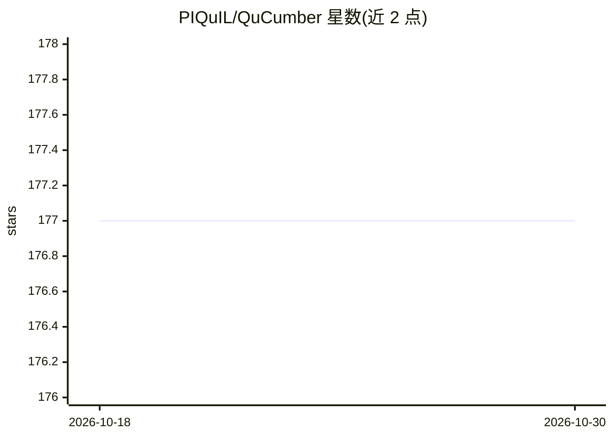

# PIQuIL/QuCumber

⭐ 177 · Python · NOASSERTION · 推送 2026-10-28 · [GitHub](https://github.com/PIQuIL/QuCumber) · [官网](https://qucumber.readthedocs.io/) · 组织维护

**用受限玻尔兹曼机从测量数据重构多体量子波函数**

从二进制测量计数（如轨道占据、量子比特角动量本征值）构成训练集，训练两层受限玻尔兹曼机（RBM），得到未知波函数的重构表示。重构后的网络可用于生成式建模（产生新测量样本）并计算原数据集未包含的估计量。支持纯态（正/复波函数）与混合态的重构；复波函数与混合态需要额外基底的测量数据。由 Perimeter Institute 量子智能实验室（PIQuIL）开发，pip 安装，支持 Python 3.6+。

## 筛选速览

| 维度 | 判定 | 备注 |
|---|---|---|
| AI 角色 | `ai-native` | 本体是模型或模型工具 |
| 许可风险 | `none` | NOASSERTION |
| 部署形态 | `library` | 以包/库形式分发 |
| 模型依赖 | — | README 未给出锁定关系 |
| 硬件要求 | — | 无带数字的原话,不猜 |
| 安装摩擦 | `low` | 无编译、无系统依赖或容器化 |
| 成熟度 | — | 结构信号不足 |

## 能力要点

- 两层 RBM 无监督生成式建模重构量子波函数
- 支持纯态（正/复）与混合态的量子态重构/层析
- 隐藏层大小作为超参数可系统性控制表示误差
- 配 arXiv/SciPost 论文《QuCumber: wavefunction reconstruction with neural networks》

## 适用场景

- 从量子测量数据重构多体本征态波函数
- 用重构的波函数生成新测量样本并计算估计量
- 开展基于神经网络的量子态层析研究

## 场景标签

`科研工具` · 领域:学习与行业

## 证据(README 行号)

> L14: QuCumber is a program that reconstructs an unknown quantum wavefunction
> L18: stochastic neural network called a Restricted Boltzmann Machine. Once trained, the

## 星数曲线

2026-10-18 177 → 2026-10-30 177（+0）

---
*卡片 v1 · prompt 1.4 · 生成 2026-10-22 · 置信度 high · 依据 README sha `83f5a2234598` · [字段定义](../../DATASET.md)*
