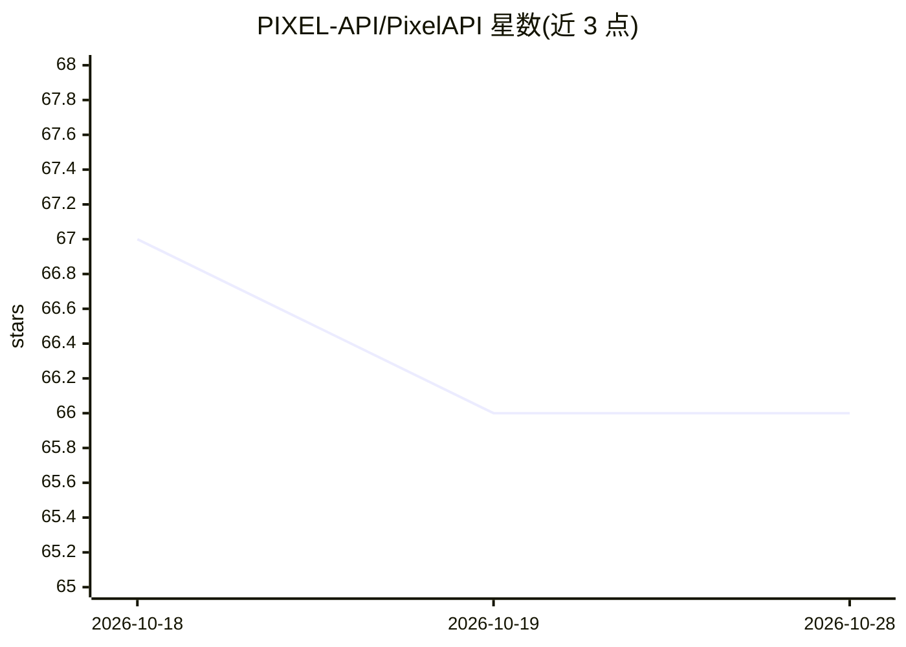

# PIXEL-API/PixelAPI

⭐ 66 · Go · LGPL-3.0 · 推送 2026-09-18 · [GitHub](https://github.com/PIXEL-API/PixelAPI) · [官网](https://ai-pixel.online) · 组织维护 · 中文 README

**账号共享型 AI API 网关：多平台接入、调度与 Token 级分账**

基于 Sub2API（fork 自 v0.1.119）二次开发的 AI API 网关平台，用 Go + Vue 3 + PostgreSQL + Redis 构建。把 Claude、OpenAI/Codex、Gemini、Antigravity、Grok 等订阅账号接入统一网关，对外提供 Anthropic/OpenAI/Gemini 多协议端点，对内负责鉴权、分组调度、并发控制与 Token 级计费。重心为多方账号共享：私有/公共/账号广场三种模式，号主托管账号获得收益账本、结算比例与提现流程，另含发卡商城、风控面板与显式 SQL 迁移。README 明确提示可能违反上游服务商条款的合规风险。

## 筛选速览

| 维度 | 判定 | 备注 |
|---|---|---|
| AI 角色 | `ai-ecosystem` | LLM/agent 周边工具 |
| 许可风险 | `viral` | LGPL-3.0 |
| 部署形态 | `self-host` | docker 或自建部署 |
| 模型依赖 | locked-api |  |
| 硬件要求 | — | 无带数字的原话,不猜 |
| 安装摩擦 | `low` | 无编译、无系统依赖或容器化 |
| 成熟度 | — | 结构信号不足 |

## 能力要点

- 私有/公共/账号广场三种账号共享模式，含房间预约、排队与结算生命周期
- 兼容 Anthropic Messages、OpenAI Chat Completions/Responses、Gemini generateContent 等多协议端点
- Token 级计费、号主收益账本、结算比例与提现，计费异常熔断
- 每账号独立出站代理、健康探测与不可用账号自动重排

## 适用场景

- 站长搭建多平台 AI 账号池并对外提供标准 API
- 号主托管账号、按调用产生收益并提现
- 团队统一管理多账号的鉴权、限流与用量核算

## 场景标签

`模型网关` · 领域:Agent 开发

## 证据(README 行号)

> L20: PixelAPI 把 AI 订阅账号（Claude、Codex/OpenAI、Gemini、Antigravity、Grok）接入统一网关，
> L21: 对外以标准 API 协议提供服务，对内负责鉴权、调度、并发控制、Token 级计费与账务结算。

## 星数曲线

2026-10-18 67 → 2026-10-28 66（-1）

---
*卡片 v1 · prompt 1.4 · 生成 2026-10-24 · 置信度 high · 依据 README sha `7f3ae43143c3` · [字段定义](../../DATASET.md)*
