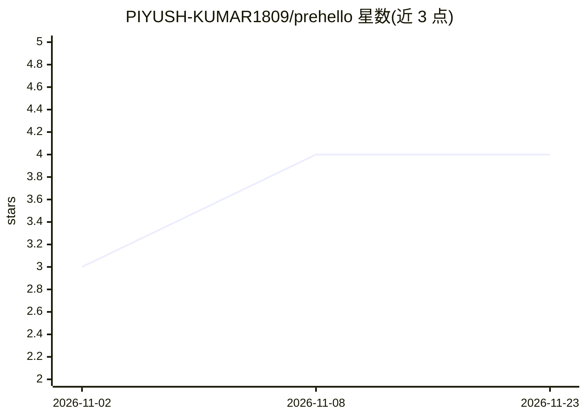

# PIYUSH-KUMAR1809/prehello

⭐ 4 · TypeScript · MIT · 推送 2026-11-07 · [GitHub](https://github.com/PIYUSH-KUMAR1809/prehello) · [官网](https://www.npmjs.com/package/prehello) · 个人维护

**本地 CLI：审计 coding agent 启动前加载的上下文 token 占用**

prehello 扫描仓库与用户级 agent 配置，统计 Claude Code、Cursor、Codex、GitHub Copilot、Gemini CLI 会话开始前已加载的规则、skills、插件列表与 MCP 服务器数量，按 o200k 分词器估算 token 数并给出误差区间，输出排名式"可裁剪清单"、分享卡片、Markdown/SARIF 报告与 --max-tokens CI 门禁。完全本地只读，无网络、无遥测、无 API key；不启动 MCP 服务器，不改动文件（--fix 仅为干跑）。附带对 559 个公开仓库的基准数据与 GitHub Action，可在每个 PR 上更新上下文占用评论。

## 筛选速览

| 维度 | 判定 | 备注 |
|---|---|---|
| AI 角色 | `ai-ecosystem` | LLM/agent 周边工具 |
| 许可风险 | `permissive` | MIT |
| 部署形态 | `library` | 以包/库形式分发 |
| 模型依赖 | — | README 未给出锁定关系 |
| 硬件要求 | — | 无带数字的原话,不猜 |
| 安装摩擦 | `low` | 无编译、无系统依赖或容器化 |
| 成熟度 | — | 结构信号不足 |

## 能力要点

- 本地只读扫描，无网络、无遥测、无 API key、无子进程
- 输出排名式 what-to-cut 清单与 PNG/SVG 分享卡片
- 支持 SARIF、JSON、Markdown 输出与 --max-tokens CI 门禁
- GitHub Action 在每个 PR 留下基线/变更对照评论

## 适用场景

- 上线前审计仓库里 agent 配置文件的上下文开销
- 在 CI 中设置 token 预算门禁防止配置膨胀
- 定位具体哪个插件或 skill 文件夹占用最多 token
- 用 calibrate 与 Claude Code /context 读数交叉核对估算

## 场景标签

 · 领域:开发者工具/LLM 基础设施

## 证据(README 行号)

> L11: Every **Claude Code, Cursor, Codex, GitHub Copilot and Gemini CLI** session starts with rules, skills, plugin listi
> L13: **how many tokens that is, which plugin or file is responsible, and roughly what removing the top few would save.**
> L17: - **Actionable.** A ranked "what to cut" list, a share card, a PR comment on every pull request, a badge, SARIF and

## 星数曲线

2026-11-02 3 → 2026-11-23 4（+1）

---
*卡片 v1 · prompt 1.4 · 生成 2026-11-21 · 置信度 mid · 依据 README sha `abedc59e4edd` · [字段定义](../../DATASET.md)*
