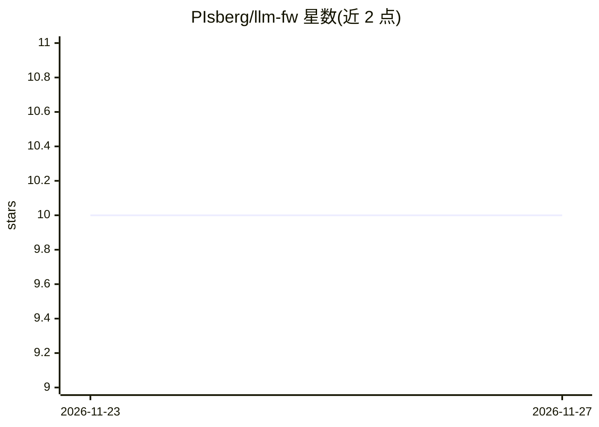

# PIsberg/llm-fw

⭐ 10 · TypeScript · NOASSERTION · 推送 2026-11-26 · [GitHub](https://github.com/PIsberg/llm-fw) · 个人维护

**本地运行的提示注入防火墙：拦截工具与 LLM API 之间的流量**

以本地 HTTP 代理形式部署，通过 HTTPS_PROXY 接管工具到各大 LLM API 的流量，在请求出机前经三级管线检测：启发式规则（含多编码解码）、本地多语言 ONNX 嵌入相似度、可选的本地分类器与 Ollama judge。命中注入的请求返回 422，被标记的工具结果被扣留，干净流量原样转发；内置本地仪表盘（localhost:7731）实时展示拦截事件、回放测试与误报标记，另提供 DLP 密钥扫描、DoS 熔断、MCP 工具防火墙、RAG 投毒检测等防御。面向在本地开发中使用 LLM API 的开发者；许可证为 PolyForm Noncommercial，商业使用需另行购买商业许可。

## 筛选速览

| 维度 | 判定 | 备注 |
|---|---|---|
| AI 角色 | `ai-ecosystem` | LLM/agent 周边工具 |
| 许可风险 | `none` | NOASSERTION |
| 部署形态 | `library` | 以包/库形式分发 |
| 模型依赖 | local-ok | 支持本地模型 |
| 硬件要求 | — | 无带数字的原话,不猜 |
| 安装摩擦 | `low` | 无编译、无系统依赖或容器化 |
| 成熟度 | — | 结构信号不足 |

## 能力要点

- 三级检测管线：启发式 → 跨语言嵌入 → 可选本地 LLM judge
- 以 HTTPS_PROXY 方式接入，零代码改动，全流程本地运行
- 仪表盘支持实时拦截展示、playground 回放与误报抑制
- 附加 DLP 密钥扫描、MCP 工具防火墙、RAG 投毒与 ASCII 走私防御

## 适用场景

- 本地代理层拦截发往各大 LLM API 的提示注入请求
- 对 agent 流水线中不可信的工具输出单独收紧阈值
- 审计并回放被拦截的请求，标记误报避免重复拦截

## 场景标签

`网络安全` · 领域:学习与行业

## 证据(README 行号)

> L14: **llm-fw** is a local firewall for LLM traffic. It sits between your tools and the APIs they call, inspects every r
> L19: - 🔌 **No code changes.** Point `HTTPS_PROXY` at it — or enable the OS-level sinkhole for Node.js and native binarie
> L99: llm-fw sits between your client and the API using a standard HTTP proxy (`HTTPS_PROXY`). It terminates TLS locally,

## 星数曲线

2026-11-23 10 → 2026-11-27 10（+0）

---
*卡片 v1 · prompt 1.4 · 生成 2026-11-23 · 置信度 high · 依据 README sha `5fc43aaaa3f3` · [字段定义](../../DATASET.md)*
