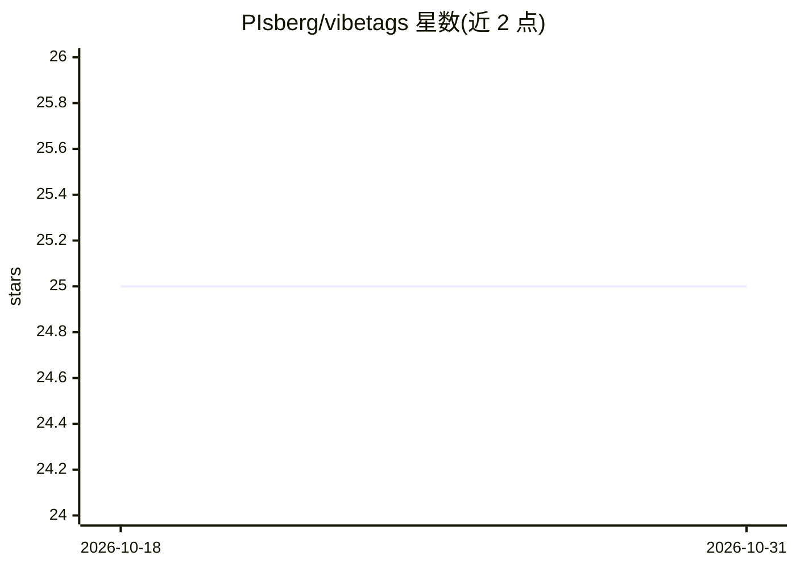

# PIsberg/vibetags

⭐ 25 · Java · MIT · 推送 2026-10-30 · [GitHub](https://github.com/PIsberg/vibetags) · 个人维护

**Java 注解处理器：编译期生成 29 个 AI 编码工具的护栏配置**

面向 Java/Kotlin 开发者的编译期注解处理器：在源码上加 @AILocked、@AIPrivacy 等 44 个注解，mvn compile 时自动生成并更新 Cursor 的 .cursorrules、Claude 的 CLAUDE.md 等 46 个平台护栏文件，注解保留策略为 SOURCE、无运行时开销。支持按平台 scoped-rules 目录拆分规则以控制上下文体积，提供 CI 检查模式在护栏与注解漂移时使构建失败。构建工具支持 Maven、Gradle、kapt 与 KSP，Kotlin 经 kapt 时函数体内注解不可见。

## 筛选速览

| 维度 | 判定 | 备注 |
|---|---|---|
| AI 角色 | `ai-ecosystem` | LLM/agent 周边工具 |
| 许可风险 | `permissive` | MIT |
| 部署形态 | `None` |  |
| 模型依赖 | locked-api |  |
| 硬件要求 | — | 无带数字的原话,不猜 |
| 安装摩擦 | `medium` | 含编译或系统依赖之一 |
| 成熟度 | — | 结构信号不足 |

## 能力要点

- 44 个注解生成 29 个 AI 平台的 46 个护栏配置文件
- SOURCE 保留策略，编译期擦除，零运行时开销
- CI 检查模式检测护栏文件与注解漂移并使构建失败
- 支持 Maven/Gradle/kapt/KSP，兼容 Kotlin 与 Groovy

## 适用场景

- 团队统一 AI 编码工具的项目规则，避免手工维护 .cursorrules/CLAUDE.md 漂移
- 保护支付等关键代码不被 AI 编码助手改动
- 在 CI 中强制执行 AI 护栏与锁定文件的变更约束

## 场景标签

`代码生成` · 领域:编码与开发

## 证据(README 行号)

> L24: **VibeTags** is a compile-time Java annotation processor that generates AI platform-specific guardrail files from s
> L220: VibeTags provides Java annotations that serve as instructions for AI code generation tools. When your project is c

## 星数曲线

2026-10-18 25 → 2026-10-31 25（+0）

---
*卡片 v1 · prompt 1.4 · 生成 2026-10-27 · 置信度 high · 依据 README sha `fdb8a541adb1` · [字段定义](../../DATASET.md)*
