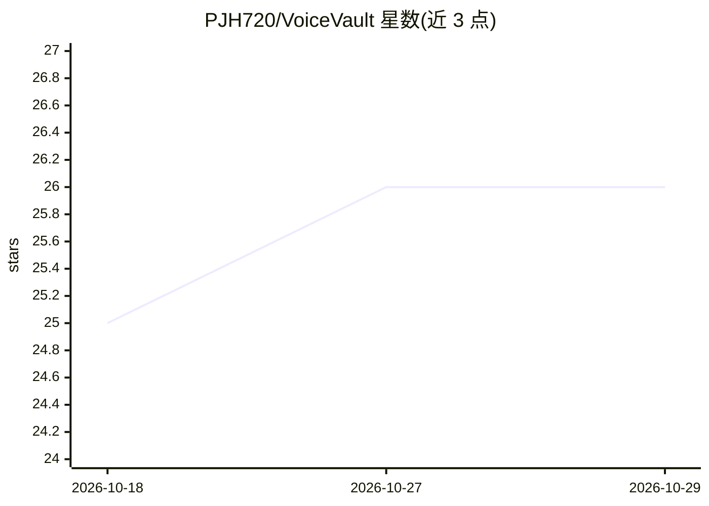

# PJH720/VoiceVault

⭐ 26 · TypeScript · MIT · 推送 2026-04-25 · [GitHub](https://github.com/PJH720/VoiceVault) · 个人维护

**本地优先的桌面录音应用：AI 转写、摘要、分类与 RAG 检索**

Electrobun 桌面应用，面向个人用户录制讲座、会议与对话。通过 whisper-cli 子进程在设备上实时转写语音，每分钟生成本地 LLM（llama-cli 加载 GGUF 模型）摘要，并将录音分类为讲义、会议纪要、对话记录、备忘等七种内置模板。支持跨录音的自然语言 RAG 搜索，可导出带 YAML frontmatter 与 wikilinks 的 Obsidian Markdown 文件。默认完全离线运行，可选接入 Claude/OpenAI/Gemini 云端 API。提供 macOS（Apple Silicon）与 Linux x64 安装包，Windows 未测试。

## 筛选速览

| 维度 | 判定 | 备注 |
|---|---|---|
| AI 角色 | `ai-native` | 本体是模型或模型工具 |
| 许可风险 | `permissive` | MIT |
| 部署形态 | `desktop` | 安装包/桌面程序 |
| 模型依赖 | local-ok | 支持本地模型 |
| 硬件要求 | — | 无带数字的原话,不猜 |
| 安装摩擦 | `low` | 无编译、无系统依赖或容器化 |
| 成熟度 | — | 结构信号不足 |

## 能力要点

- whisper-cli 设备端实时转写，无需联网
- 本地 LLM（llama-cli + GGUF）每分钟自动摘要与录音分类
- 跨录音自然语言 RAG 搜索，答案带来源与时间戳
- 导出 Obsidian 兼容 Markdown，含 YAML frontmatter 与 wikilinks

## 适用场景

- 录制讲座或会议并自动生成结构化笔记
- 用自然语言检索过去的录音内容
- 将录音整理进 Obsidian 知识库

## 场景标签

`语音识别` `RAG` `知识库管理` · 领域:知识与检索

## 证据(README 行号)

> L10: An open-source desktop app that transcribes, summarizes, and auto-organizes your recordings
> L18: **VoiceVault changes that.** It transcribes everything with on-device Whisper, then uses AI to:
> L31: See your words appear as text while you speak. VoiceVault uses `whisper-cli` (on-device, via `Bun.spawn` subprocess
> L46: Classification is fully offline using local LLM via `llama-cli`. Custom templates are JSON files in `templates/`.

## 星数曲线

2026-10-18 25 → 2026-10-29 26（+1）

---
*卡片 v1 · prompt 1.4 · 生成 2026-10-27 · 置信度 high · 依据 README sha `252c4942796c` · [字段定义](../../DATASET.md)*
