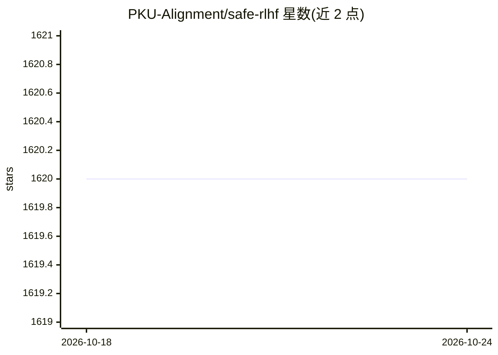

# PKU-Alignment/safe-rlhf

⭐ 1,620 · Python · Apache-2.0 · 推送 2025-11-24 · [GitHub](https://github.com/PKU-Alignment/safe-rlhf) · [官网](https://pku-beaver.github.io) · 组织维护 · 中文 README

**面向约束价值对齐研究的 Safe RLHF 训练框架与数据集**

北京大学 PKU-Alignment 团队开发的开源 RLHF 框架 Beaver：提供从 SFT、奖励/代价模型训练到 RLHF 与 Safe RLHF（拉格朗日 PPO）的完整可复现训练管线，支持 LLaMA、OPT、Baichuan 等预训练模型，基于 DeepSpeed 后端。配套发布 PKU-SafeRLHF 人类标注偏好数据集（最多 1M 对，含帮助性与无害性双维度）及 Beaver-7B 模型与 Reward/Cost Model 检查点（Hugging Face）。训练在 8×A800-80GB 上测试，可开 ZeRO-Offload 缓解显存压力；方法论文被 ICLR 2024 接收为 Spotlight。

## 筛选速览

| 维度 | 判定 | 备注 |
|---|---|---|
| AI 角色 | `ai-ecosystem` | LLM/agent 周边工具 |
| 许可风险 | `permissive` | Apache-2.0 |
| 部署形态 | `library` | 以包/库形式分发 |
| 模型依赖 | — | README 未给出锁定关系 |
| 硬件要求 | — | 无带数字的原话,不猜 |
| 安装摩擦 | `low` | 无编译、无系统依赖或容器化 |
| 成熟度 | — | 结构信号不足 |

## 能力要点

- 覆盖 SFT→偏好模型→RLHF→Safe RLHF→评测的完整管线
- PKU-SafeRLHF 人类标注数据集（10K/30万/1M 对，含安全偏好标签）
- 提供 Reward Model 与 Cost Model 训练及预训练检查点
- 支持 ZeRO-Offload 与多节点（hostfile）训练

## 适用场景

- 做 LLM 安全对齐/约束对齐的复现研究
- 用自己的偏好数据训练奖励与代价模型
- 基于 LLaMA 等底座跑完整 Safe RLHF 训练流程

## 场景标签

`强化学习` `模型训练` · 领域:训练与推理

## 证据(README 行号)

> L3: Beaver is a highly modular open-source RLHF framework developed by the PKU-Alignment team at Peking University.
> L8: - Support **SFT**, **RLHF** and **Safe RLHF** training for popular pre-trained models: LLaMA, OPT, Baichuan, etc.
> L124: `safe-rlhf` supports a complete pipeline from Supervised Fine-Tuning (SFT) to preference model training to RLHF al

## 星数曲线

2026-10-18 1,620 → 2026-10-24 1,620（+0）

---
*卡片 v1 · prompt 1.4 · 生成 2026-10-21 · 置信度 high · 依据 README sha `159976804d38` · [字段定义](../../DATASET.md)*
