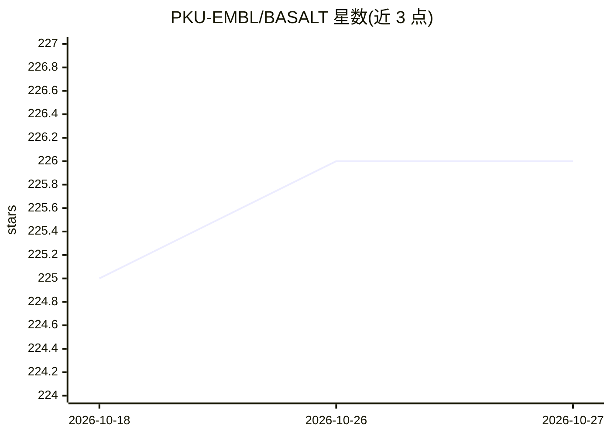

# PKU-EMBL/BASALT

⭐ 226 · Python · MIT · 推送 2026-09-29 · [GitHub](https://github.com/PKU-EMBL/BASALT) · [官网](https://basalt-guide.readthedocs.io/en/latest/) · 组织维护 · 中文 README

**宏基因组分箱工具包：从组装与测序数据恢复并精修 MAGs**

面向宏基因组研究者的 MAG（宏基因组组装基因组）恢复与精修流程：跨多个组装运行多分箱器（MetaBAT 2、SemiBin 2、CONCOCT、MaxBin 2.0）生成候选 bin，经组装内与跨组装选择、五模型 MLP 集成在 contig 级筛查污染并检索序列，最后重装配与补缺口。支持短读、ONT/PacBio CLR、HiFi 及组合输入。要求 Linux x86-64、Python 3.12、8 线程/128 GB RAM 起点，经 Conda/Micromamba 安装，另提供 Pixi 实现的新版本 BASALT-Air。

## 筛选速览

| 维度 | 判定 | 备注 |
|---|---|---|
| AI 角色 | `ai-native` | 本体是模型或模型工具 |
| 许可风险 | `permissive` | MIT |
| 部署形态 | `library` | 以包/库形式分发 |
| 模型依赖 | — | README 未给出锁定关系 |
| 硬件要求 | — | 无带数字的原话,不猜 |
| 安装摩擦 | `low` | 无编译、无系统依赖或容器化 |
| 成熟度 | — | 结构信号不足 |

## 能力要点

- 多分箱器候选生成（MetaBAT 2/SemiBin 2/CONCOCT/MaxBin 2.0，含三档预设）
- 五模型 MLP 集成做 contig 级污染筛查与序列检索
- 跨组装（个体+共组装）的 bin 选择、去冗余与重装配一体化流水线
- 断点续跑与内容缓存 CheckM2 评估；支持外部 binset 导入

## 适用场景

- 从宏基因组组装数据恢复并精修高质量 MAGs
- 纵向/时序样本研究中联合评估个体组装与共装配
- 导入其他流程的 bin 做去冗余、精修与补缺口

## 场景标签

 · 领域:生物信息学/宏基因组

## 证据(README 行号)

> L10: BASALT is a metagenomic workflow for recovering and refining metagenome-assembled genomes (MAGs) across one or more
> L70: 3. **Refinement.** A five-model multilayer-perceptron ensemble screens contigs using sequence-composition and cover

## 星数曲线

2026-10-18 225 → 2026-10-27 226（+1）

---
*卡片 v1 · prompt 1.4 · 生成 2026-10-22 · 置信度 mid · 依据 README sha `3873049ea2b0` · [字段定义](../../DATASET.md)*
