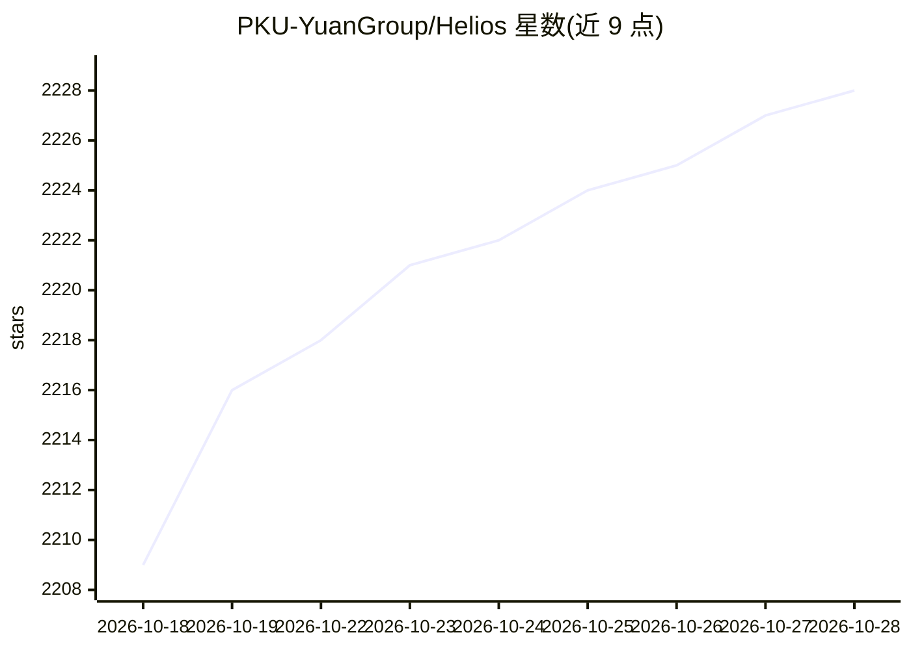

# PKU-YuanGroup/Helios

⭐ 2,230 · Python · Apache-2.0 · 推送 2026-08-24 · [GitHub](https://github.com/PKU-YuanGroup/Helios) · [官网](https://pku-yuangroup.github.io/Helios-Page) · 组织维护 · 中文 README

**北大团队开源的 14B 实时长视频生成模型**

Helios 的官方实现：自回归扩散视频生成模型，按每块 33 帧分块生成分钟级视频，在单张 H100 上端到端推理 19.5 FPS。不依赖常规抗漂移策略（self-forcing、关键帧采样等）与标准加速技术（KV-cache、稀疏注意力、量化等）。发布 Base/Mid/Distilled 三个 14B 权重，支持文生视频、图生视频、视频续写与交互式生成；提供 Group Offloading（约 6GB 显存）与多卡上下文并行，适配 Ascend NPU、Diffusers、SGLang-Diffusion、vLLM-Omni。限制：I2V/V2V 因基于 T2V 训练质量可能略逊；帧数需为 33 的倍数。

## 筛选速览

| 维度 | 判定 | 备注 |
|---|---|---|
| AI 角色 | `ai-native` | 本体是模型或模型工具 |
| 许可风险 | `permissive` | Apache-2.0 |
| 部署形态 | `library` | 以包/库形式分发 |
| 模型依赖 | local-ok | 支持本地模型 |
| 硬件要求 | `gpu-8g` | |
| 安装摩擦 | `medium` | 含编译或系统依赖之一 |
| 成熟度 | — | 结构信号不足 |

## 能力要点

- 单张 H100 达 19.5 FPS 的分钟级长视频生成（14B）
- 不使用常规抗漂移策略与标准加速技术（KV-cache、量化等）
- Group Offloading 可将显存降至约 6GB，另支持 4 卡上下文并行
- 提供 T2V/I2V/V2V/交互式四类推理脚本与 Diffusers、vLLM-Omni 管线

## 适用场景

- 从文本或图片生成长时视频内容
- 消费级显存（约 6GB）上本地运行视频生成
- 多 GPU 环境下并行推理生成长视频

## 场景标签

`视频生成` · 领域:内容生成

## 证据(README 行号)

> L19: This repository is the official implementation of Helios, which is a breakthrough video generation model that achie
> L25: 2. **Without standard acceleration techniques** (e.g., KV-cache, causal masking, sparse/linear attention, TinyVAE, 
> L124: We provide inference scripts for all models covering text-to-video, image-to-video, and video-to-video in this dir

## 星数曲线

2026-10-18 2,209 → 2026-10-28 2,228（+19）

---
*卡片 v1 · prompt 1.4 · 生成 2026-10-21 · 置信度 mid · 依据 README sha `599f74e948ba` · [字段定义](../../DATASET.md)*
