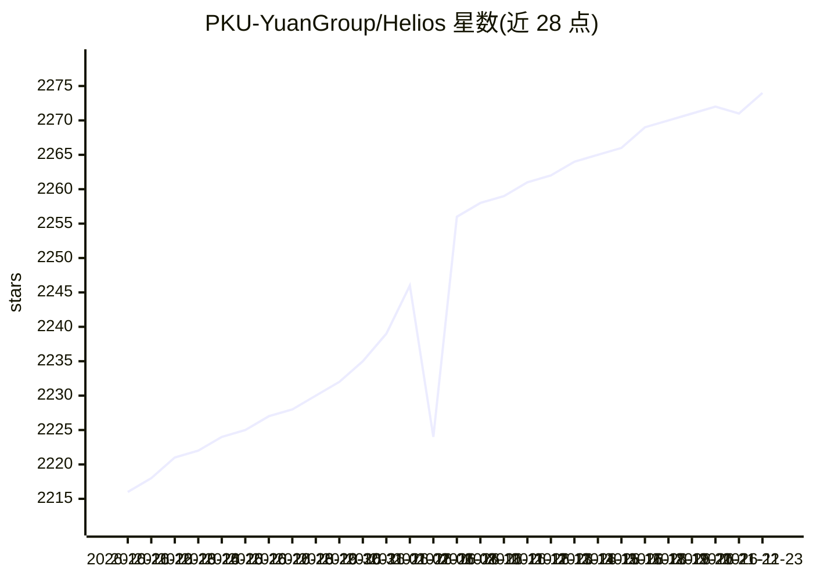

# PKU-YuanGroup/Helios

⭐ 2,274 · Python · Apache-2.0 · 推送 2026-11-01 · [GitHub](https://github.com/PKU-YuanGroup/Helios) · [官网](https://pku-yuangroup.github.io/Helios-Page) · 组织维护 · 中文 README

**14B 实时长视频生成模型：分钟级视频合成，支持图/文生视频**

北大 Yuan Group 发布的视频生成模型官方实现，14B 参数，在单张 H100 上实现 19.5 FPS 端到端推理（Ascend NPU 约 10 FPS），可生成长达分钟级的视频，且不依赖常见防漂移策略与标准加速技巧。提供 Helios-Base/Mid/Distilled 三个权重，覆盖文生视频、图生视频、视频到视频与交互式生成；采用自回归分块方式，每块生成 33 帧。提供推理脚本、Group Offloading（约 6GB VRAM）、多卡上下文并行及 Diffusers/SGLang/vLLM-Omni 管线，已获 TPAMI 录用。

## 筛选速览

| 维度 | 判定 | 备注 |
|---|---|---|
| AI 角色 | `ai-native` | 本体是模型或模型工具 |
| 许可风险 | `permissive` | Apache-2.0 |
| 部署形态 | `library` | 以包/库形式分发 |
| 模型依赖 | local-ok | 支持本地模型 |
| 硬件要求 | `gpu-8g` | |
| 安装摩擦 | `medium` | 含编译或系统依赖之一 |
| 成熟度 | — | 结构信号不足 |

## 能力要点

- 单张 H100 上 19.5 FPS 端到端实时推理（Ascend NPU 约 10 FPS）
- 三个模型版本均支持 T2V/I2V/V2V/Interactive
- Group Offloading 将 VRAM 降至约 6GB，支持多卡上下文并行（Ulysses/Ring/Unified 等）
- Diffusers、SGLang-Diffusion、vLLM-Omni Day-0 支持

## 适用场景

- 从文本或图片生成分分钟级的长视频
- 消费级显卡上通过 Group Offloading 运行视频生成
- 多 GPU 环境下并行推理生成高分辨率视频
- 通过 Diffusers 管线将模型集成到现有工作流

## 场景标签

`视频生成` · 领域:内容生成

## 证据(README 行号)

> L19: This repository is the official implementation of Helios, which is a breakthrough video generation model that achie
> L125: We provide inference scripts for all models covering text-to-video, image-to-video, and video-to-video in this dir
> L43: * `[2026.03.08]` 🚀 Helios now fully supports Group Offloading and Context Parallelism! These features significantly

## 星数曲线

2026-10-21 2,216 → 2026-11-23 2,274（+58）

---
*卡片 v1 · prompt 1.4 · 生成 2026-11-23 · 置信度 high · 依据 README sha `b51b9b2aafa8` · [字段定义](../../DATASET.md)*
