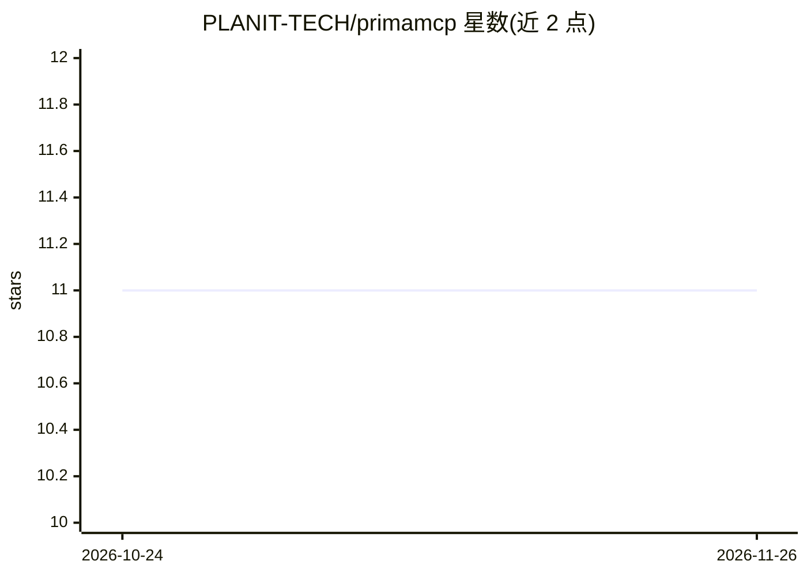

# PLANIT-TECH/primamcp

⭐ 11 · TypeScript · MIT · 推送 2026-11-13 · [GitHub](https://github.com/PLANIT-TECH/primamcp) · [官网](https://mcp.planitprima.com/) · 组织维护

**为 AI 助手提供可引用德国与欧盟法律原文的 MCP 服务器**

以 MCP 服务器形式向各类 AI 客户端提供经核验的德国与欧盟法律文本：联邦/州法律、欧盟法规、法院判例每日从官方来源更新，通过三级混合搜索（含 AI 重排序）检索，每条结果附出处与官方来源直链，缓解法律问答中的幻觉问题。提供九个工具、六个 Resources、三个 Prompts，以及面向 Cursor/Claude Code 等的预置规则与技能。托管于德国，通过 API Key/OAuth 接入，免费试用 5 天，按席位计费，限流 15–300 请求/分钟。

## 筛选速览

| 维度 | 判定 | 备注 |
|---|---|---|
| AI 角色 | `ai-ecosystem` | LLM/agent 周边工具 |
| 许可风险 | `permissive` | MIT |
| 部署形态 | `library` | 以包/库形式分发 |
| 模型依赖 | — | README 未给出锁定关系 |
| 硬件要求 | — | 无带数字的原话,不猜 |
| 安装摩擦 | `low` | 无编译、无系统依赖或容器化 |
| 成熟度 | — | 结构信号不足 |

## 能力要点

- 九个 MCP 工具：混合搜索、按引用查法条全文、批量查询、找引用判例、查立法材料等
- 覆盖 BGB、DSGVO、KI-VO、MiCA 等，数据每日更新自官方来源
- 支持 Streamable HTTP + Bearer/OAuth 2.1，兼容任何 MCP 客户端
- 提供各客户端预置 Rules/Skills/Prompts（Cursor、Claude Code、Custom-GPT）

## 适用场景

- 在 Claude/ChatGPT 中查询法条原文并附带官方出处
- 编写代码时做 DSGVO 合规检查与 AGB 条款生成
- 在 Teams 中搭建带法条引用的合规机器人

## 场景标签

`RAG` `语义搜索` · 领域:知识与检索

## 证据(README 行号)

> L34: PRIMAMCP ist ein **produktionsreifer MCP-Server**, der KI-Assistenten verifizierten Zugriff auf das deutsche und eu
> L38: **Endpunkt:** `https://mcp.planitprima.com/mcp` (Streamable HTTP, Bearer-Auth oder OAuth 2.1)

## 星数曲线

2026-10-24 11 → 2026-11-26 11（+0）

---
*卡片 v1 · prompt 1.4 · 生成 2026-11-18 · 置信度 high · 依据 README sha `4ee92abfe54a` · [字段定义](../../DATASET.md)*
