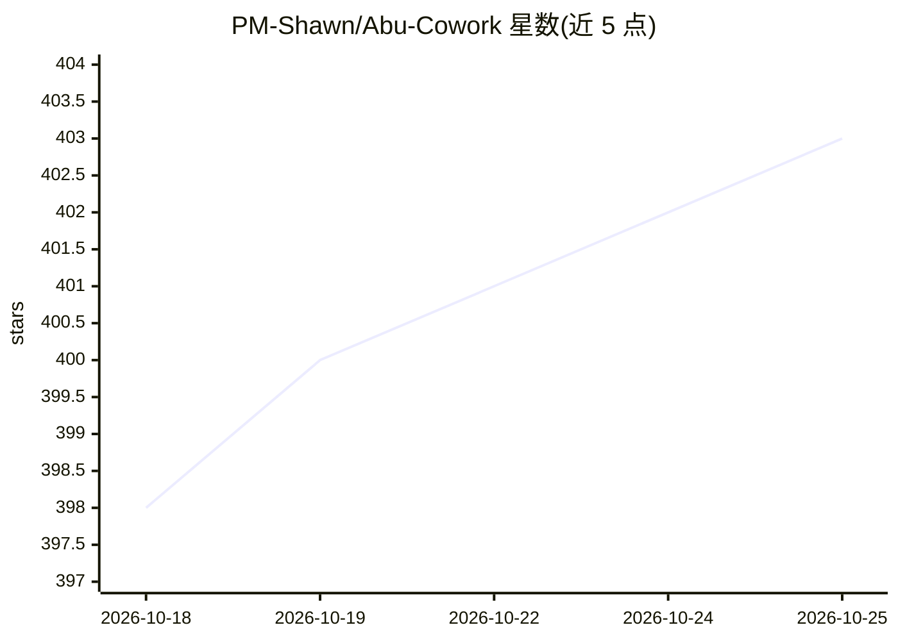

# PM-Shawn/Abu-Cowork

⭐ 403 · TypeScript · NOASSERTION · 推送 2026-10-24 · [GitHub](https://github.com/PM-Shawn/Abu-Cowork) · [官网](https://abuwork.com) · 个人维护 · 中文 README

**本地优先的 AI 桌面办公助理：自然语言驱动读写文件、执行命令与自动化**

受 Claude Code Cowork 模式启发的本地运行桌面 AI agent 应用：以自然语言下达任务，Abu 自主规划并调用工具，读写本地文件、执行命令、生成 PDF/PPTX/DOCX/Excel 等文档。支持 12+ 云端模型商、零配置 Ollama 本地模型及 OpenAI/Anthropic 兼容自定义端点。安全机制包括三档权限模式、Seatbelt 沙箱、网络隔离、密钥加密存储与内容安全扫描。另有 29 个内置技能、自我演化技能、MCP 连接器、定时任务与多种触发器、IM 机器人接入（飞书/钉钉/企微/Slack 等）、最多 5 个并行后台 agent。跨 macOS 与 Windows。

## 筛选速览

| 维度 | 判定 | 备注 |
|---|---|---|
| AI 角色 | `ai-native` | 本体是模型或模型工具 |
| 许可风险 | `none` | NOASSERTION |
| 部署形态 | `desktop` | 安装包/桌面程序 |
| 模型依赖 | local-ok | 支持本地模型 |
| 硬件要求 | — | 无带数字的原话,不猜 |
| 安装摩擦 | `low` | 无编译、无系统依赖或容器化 |
| 成熟度 | `idea` | |

## 能力要点

- 自主规划与工具调用的桌面 agent，支持读写文件、执行命令、浏览器与计算机控制
- 12+ 云端模型商 + 零配置 Ollama 本地模型 + OpenAI/Anthropic 兼容自定义端点
- 29 个内置技能与一键固化的自我演化技能
- 三档权限模式、OS 沙箱、网络隔离与内容安全扫描（120+ 风险模式）

## 适用场景

- 用自然语言让助理在本机读写文件、跑命令、产出文档与报告
- 通过定时任务、文件变更/Webhook/IM 消息触发自动执行 agent 任务
- 在飞书/钉钉/企微/Slack 中 @Abu 作为团队机器人
- 本地运行模型与数据，控制敏感文件与命令的访问边界

## 场景标签

`AI 助手` `GUI 自动化` · 领域:效率与自动化

## 证据(README 行号)

> L9: A locally-run AI desktop assistant inspired by Claude Code's Cowork mode.
> L84: - **Autonomous Agent** — More than chat: plans, invokes tools, reads/writes files, executes commands, and completes
> L105: - **12+ Cloud Providers** — Anthropic Claude, OpenAI, DeepSeek, Qwen (Bailian), Doubao (Volcengine), Moonshot, Zhi

## 星数曲线

2026-10-18 398 → 2026-10-25 403（+5）

---
*卡片 v1 · prompt 1.4 · 生成 2026-10-21 · 置信度 high · 依据 README sha `7a729365bb4e` · [字段定义](../../DATASET.md)*
