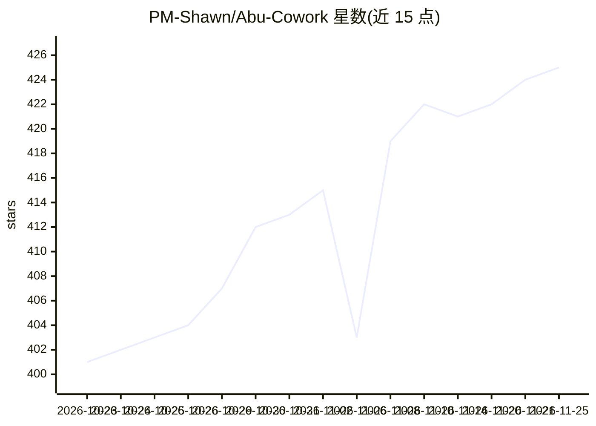

# PM-Shawn/Abu-Cowork

⭐ 425 · TypeScript · Apache-2.0 · 推送 2026-11-13 · [GitHub](https://github.com/PM-Shawn/Abu-Cowork) · [官网](https://abuwork.com) · 个人维护 · 中文 README

**桌面 AI 办公助手：一句话描述任务，规划并执行**

本地运行的桌面 AI 办公助手，灵感来自 Claude Code 的 Cowork 模式。用户以自然语言描述任务，助手自主规划并调用工具执行：读写本地文件、运行命令、生成文档/网页/报表。提供 29 个内置技能与自进化技能、最多 5 个并行后台 agent、计划模式高风险确认、三级权限模式与内容安全扫描、macOS Seatbelt 沙箱与代理网络隔离、三层文件式记忆、Cron 定时任务与事件触发、IM 机器人（Lark/钉钉/企业微信/Slack）集成。提供安装包下载与源码构建两种方式。

## 筛选速览

| 维度 | 判定 | 备注 |
|---|---|---|
| AI 角色 | `ai-native` | 本体是模型或模型工具 |
| 许可风险 | `permissive` | Apache-2.0 |
| 部署形态 | `desktop` | 安装包/桌面程序 |
| 模型依赖 | local-ok | 支持本地模型 |
| 硬件要求 | — | 无带数字的原话,不猜 |
| 安装摩擦 | `low` | 无编译、无系统依赖或容器化 |
| 成熟度 | — | 结构信号不足 |

## 能力要点

- 自主规划与工具调用：读/写文件、执行命令、端到端完成任务
- 29 个内置技能（PDF/PPTX/DOCX/Excel 生成、浏览器自动化等）+ 自进化技能
- 多 agent 并行执行（最多 5 个）与多会话 Project 聚合
- 三级权限模式、macOS Seatbelt 沙箱与 120+ 风险模式的内容安全扫描

## 适用场景

- 一句话让助手完成文件整理、报告生成等办公任务
- 通过飞书/钉钉/企业微信 @机器人 触发团队自动化任务
- 用 Cron 定时任务与文件/HTTP 触发器构建自动化工作流

## 场景标签

`AI 助手` `工作流自动化` `多智能体` · 领域:Agent 开发

## 证据(README 行号)

> L7: **Your AI Desktop Office Assistant — Just Leave It to Abu**
> L9: A locally-run AI desktop assistant inspired by Claude Code's Cowork mode.
> L84: - **Autonomous Agent** — More than chat: plans, invokes tools, reads/writes files, executes commands, and completes

## 星数曲线

2026-10-23 401 → 2026-11-25 425（+24）

---
*卡片 v1 · prompt 1.4 · 生成 2026-11-25 · 置信度 high · 依据 README sha `493f4d662426` · [字段定义](../../DATASET.md)*
