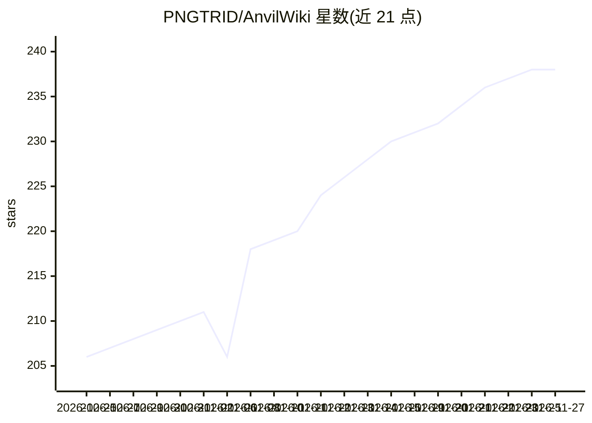

# PNGTRID/AnvilWiki

⭐ 238 · TypeScript · MIT · 推送 2026-11-26 · [GitHub](https://github.com/PNGTRID/AnvilWiki) · [官网](http://anvil.wiki/zh/landing/) · 个人维护 · 中文 README

**不会编程者也能建游戏攻略 wiki 的静态站模板，AI 对话产页**

基于 Astro + Cloudflare Pages 的游戏内容站模板：fork 后按手册执行 5 条命令或走零命令 GitHub Actions 路径即可部署，面向想通过 SEO 流量与广告变现、但不会编程的个人。AI 部分包括随仓库分发的 6 个 agent 技能（挖词选品、产页、批量内页、兑换码更新等），对话生成后自动跑内容质检与构建；批量产页经 8 道质量门禁的 PR 管道人工审后合并；另带 anvilwiki-ops 工具追踪多站数据与 AI 引用来路。许可 MIT，托管零成本，唯一必要开销是域名。

## 筛选速览

| 维度 | 判定 | 备注 |
|---|---|---|
| AI 角色 | `ai-enhanced` | 去掉 AI 部分产品仍成立 |
| 许可风险 | `permissive` | MIT |
| 部署形态 | `library` | 以包/库形式分发 |
| 模型依赖 | — | README 未给出锁定关系 |
| 硬件要求 | — | 无带数字的原话,不猜 |
| 安装摩擦 | `low` | 无编译、无系统依赖或容器化 |
| 成熟度 | — | 结构信号不足 |

## 能力要点

- 6 个 agent 技能随仓库分发，ZCode/Claude Code/Codex/Cursor 对话即产页
- 批量产页走 PR 门控管道：AI 写、8 道质量门禁验、人工审核后合并
- 中英双语学习手册（6 阶段 29 课）+ 开发手册（9 课），含可复制 AI 提示词
- SEO 工程化：sitemap/JSON-LD/hreflang/llms.txt 自动生成，AdSense/Adsterra 广告位默认关闭

## 适用场景

- 为某款 Roblox/Steam 游戏搭建攻略、兑换码、强度榜 wiki 站
- 不会编程的副业者从选品到广告变现全程照手册走完
- 用 AI 助手批量从关键词清单生成内页草稿并审核合并
- 用一套 anvilwiki-ops 工具同时管理多个游戏内容站

## 场景标签

`AI 写作` · 领域:内容生成

## 证据(README 行号)

> L72: AnvilWiki 是一个**游戏 SEO 内容站模板**——用来快速搭建围绕某款游戏(Roblox、Steam 新游等)的攻略内容站,通过 SEO 获取流量,通过广告变现。**广告收入 100% 归你**:无平台抽成、无收入分成
> L81: - 🤖 **AI 对话即产页**:内容技能随仓库分发(`.agent/skills/`),对 ZCode / Claude Code / Codex 说「根据这些笔记写篇攻略」,产出自动通过构建质检;批量产页走 **PR 门控管道
> L199: AnvilWiki is an **open-source game wiki site template**: build a content site around a game (Roblox, Steam new rel

## 星数曲线

2026-10-25 206 → 2026-11-27 238（+32）

---
*卡片 v1 · prompt 1.4 · 生成 2026-11-25 · 置信度 high · 依据 README sha `b7960c03e94a` · [字段定义](../../DATASET.md)*
