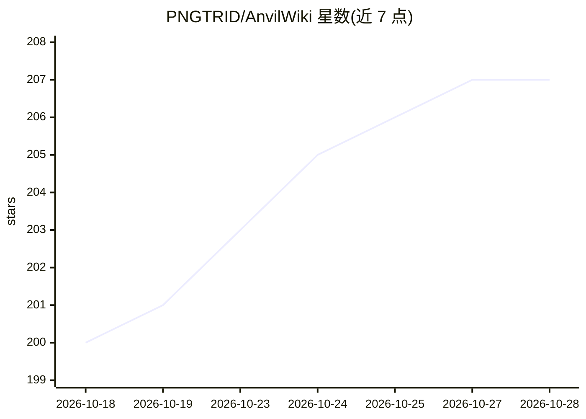

# PNGTRID/AnvilWiki

⭐ 208 · TypeScript · MIT · 推送 2026-10-28 · [GitHub](https://github.com/PNGTRID/AnvilWiki) · [官网](http://anvil.wiki/zh/landing/) · 个人维护 · 中文 README

**面向零基础用户的开源游戏 wiki 站模板，带 AI 产页工作流**

基于 Astro + Cloudflare Pages 的静态游戏 SEO 内容站模板：fork 后按手册部署，围绕某款游戏建攻略站，通过 SEO 引流与 AdSense/Adsterra 广告变现，收入归站长。AI 部分：仓库内置 6 个内容技能，用 Claude Code/Codex/Cursor 等 agent 对话生成 MDX 页面，批量产页走 PR 门控管道（八道质量门禁）；另有 anvilwiki-ops 工具拉取 GSC/Cloudflare 数据并追踪 AI 搜索来路。配套双语零基础手册与多语言、Lighthouse 优化等建站特性。

## 筛选速览

| 维度 | 判定 | 备注 |
|---|---|---|
| AI 角色 | `ai-enhanced` | 去掉 AI 部分产品仍成立 |
| 许可风险 | `permissive` | MIT |
| 部署形态 | `library` | 以包/库形式分发 |
| 模型依赖 | — | README 未给出锁定关系 |
| 硬件要求 | — | 无带数字的原话,不猜 |
| 安装摩擦 | `low` | 无编译、无系统依赖或容器化 |
| 成熟度 | — | 结构信号不足 |

## 能力要点

- 内置 6 个 agent 技能：对话生成 MDX 攻略页并自动构建自检
- 批量产页走 PR 门控管道：AI 写、八道质量门禁验、人工审后合并
- Astro 静态输出 + Cloudflare Pages 免费部署，Lighthouse 4×100
- anvilwiki-ops（npx + MCP）拉取 GSC/Cloudflare 数据并追踪 ChatGPT/Perplexity 引用来路

## 适用场景

- 不会编程，想快速建一个游戏攻略站并通过广告变现
- 用 AI 助手对话批量生成和维护 wiki 内容
- 一人管理多个游戏内容站并做 SEO 运营

## 场景标签

`工作流自动化` `AI 写作` · 领域:效率与自动化

## 证据(README 行号)

> L71: AnvilWiki 是一个**游戏 SEO 内容站模板**——用来快速搭建围绕某款游戏(Roblox、Steam 新游等)的攻略内容站,通过 SEO 获取流量,通过广告变现。**广告收入 100% 归你**:无平台抽成、无收入分成
> L73: 技术栈是 **Astro + Cloudflare Pages**:纯静态输出、零适配器、免费无限带宽、全球 CDN、零 JS 优先(首屏极快)。
> L80: - 🤖 **AI 对话即产页**:内容技能随仓库分发(`.agent/skills/`),对 ZCode / Claude Code / Codex 说「根据这些笔记写篇攻略」,产出自动通过构建质检;批量产页走 **PR 门控管道

## 星数曲线

2026-10-18 200 → 2026-10-28 207（+7）

---
*卡片 v1 · prompt 1.4 · 生成 2026-10-22 · 置信度 mid · 依据 README sha `32e577ef8e01` · [字段定义](../../DATASET.md)*
