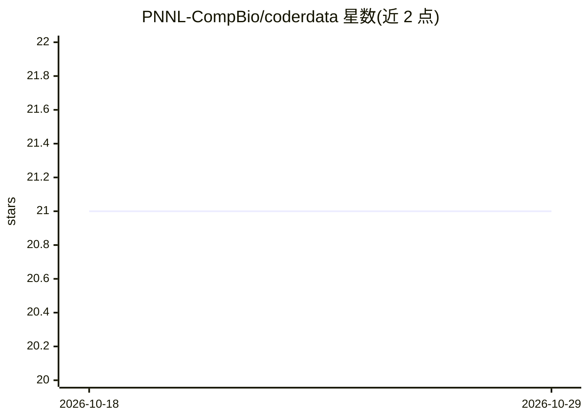

# PNNL-CompBio/coderdata

⭐ 21 · Jupyter Notebook · BSD-2-Clause · 推送 2026-10-28 · [GitHub](https://github.com/PNNL-CompBio/coderdata) · [官网](https://pnnl-compbio.github.io/coderdata/) · 组织维护

**癌症模型药敏基准数据集包：供机器学习训练测试**

由 PNNL 计算生物学团队构建的药物反应基准数据集包：汇集多来源配对分子组学数据与药敏数据，重处理并按 LinkML 维护的 CoderData schema 标准化为文本格式（逗号/制表符分隔），供预测癌症模型药物处理的深度学习算法做训练与测试评估。数据经文档站点从 Figshare 获取，也可用 Python 包下载；提供 coderbuild 构建流程，支持本地复建及通过 shell 脚本、PubChem 检索脚本与 Docker 容器添加新数据集。

## 筛选速览

| 维度 | 判定 | 备注 |
|---|---|---|
| AI 角色 | `ai-knowledge` | 知识聚合/清单类 |
| 许可风险 | `permissive` | BSD-2-Clause |
| 部署形态 | `self-host` | docker 或自建部署 |
| 模型依赖 | — | README 未给出锁定关系 |
| 硬件要求 | — | 无带数字的原话,不猜 |
| 安装摩擦 | `low` | 无编译、无系统依赖或容器化 |
| 成熟度 | — | 结构信号不足 |

## 能力要点

- 多来源组学与药敏数据的协调与标准化，形成基准数据集
- LinkML 维护的 CoderData schema 与数据校验流程
- coderbuild 流程支持本地构建与新增数据集（Dockerfile + build_all.py）

## 适用场景

- 为药物反应预测算法提供标准化训练/测试基准数据
- 比较不同深度学习模型在统一数据模式上的表现
- 将自己的组学药敏数据集按 schema 纳入该基准

## 场景标签

`模型评测` · 领域:评测与运维

## 证据(README 行号)

> L3: There is a recent explosion of deep learning algorithms that to tackle the computational problem of predicting drug 
> L5: This package collects diverse sets of paired molecular datasets with corresponding drug sensitivity data. All data h
> L15: The goal of this repository is two-fold: First, it aims to collate and

## 星数曲线

2026-10-18 21 → 2026-10-29 21（+0）

---
*卡片 v1 · prompt 1.4 · 生成 2026-10-28 · 置信度 mid · 依据 README sha `f8acaa350e79` · [字段定义](../../DATASET.md)*
