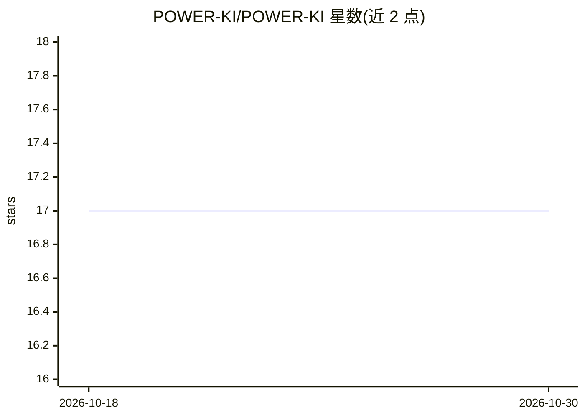

# POWER-KI/POWER-KI

⭐ 17 · C++ · 推送 2026-08-13 · [GitHub](https://github.com/POWER-KI/POWER-KI) · [官网](http://www.POWER-KI.com) · 组织维护

**面向工业自动化的编程语言及开发环境，含本地 LLM 推理能力**

XPLAB 开发的 Windows 专有编程语言，自 2010 年起用于工厂自动化/Factory 4.0 场景，也可用于 Web/eCommerce、IoT 与决策管理系统。提供 DEVELOPER（含 WorkBench IDE）、EXECUTOR 运行时与 GUI Client 三种 .msi 安装包。支持 PWK 与 Python/C/C++/JavaScript 混合编程，内置数据库、知识库、OPC-UA 等核心库。AI 能力包括本地 GGUF 模型推理的 WRAP LLM Lib（文本/图像/音频）、向量管理与 Text2Model Embedder，以及 Calcolatrice V4 的 GPT 应用。限制：仅支持 Windows 10 及以上，许可文件需放置于 c:\PWK-PRG 目录。

## 筛选速览

| 维度 | 判定 | 备注 |
|---|---|---|
| AI 角色 | `ai-enhanced` | 去掉 AI 部分产品仍成立 |
| 许可风险 | `none` | — |
| 部署形态 | `desktop` | 安装包/桌面程序 |
| 模型依赖 | — | README 未给出锁定关系 |
| 硬件要求 | — | 无带数字的原话,不猜 |
| 安装摩擦 | `low` | 无编译、无系统依赖或容器化 |
| 成熟度 | — | 结构信号不足 |

## 能力要点

- 程序代码即知识库，Data/Flow/Code 三分离的全反射可自修改架构
- WRAP LLM Lib 支持本地 GGUF 开源模型推理（文本/图像/音频、深度推理、工具调用、结构化输出）
- PWK ⇄ Python 混合编程，可经 WRAP 接入 C/C++、OpenCV、RealSense2 等库
- 含 WorkBench IDE、本地向量管理器与 Text2Model Embedder

## 适用场景

- 在工厂/产线自动化项目中开发 4.0 应用
- 构建带本地 LLM 推理能力的决策与管理系统
- 通过混合编程复用 Python 与 C/C++ 生态开发应用

## 场景标签

 · 领域:工业自动化/编程语言

## 证据(README 行号)

> L3: ### The Programming Language for Intelligent Applications (IA)
> L17: **POWER-KI establishes a new and original paradigm for programming languages.**
> L122: - **BUILD 22.119** — New **WRAP LLM Lib** for local AI inference with open models (`.gguf`).

## 星数曲线

2026-10-18 17 → 2026-10-30 17（+0）

---
*卡片 v1 · prompt 1.4 · 生成 2026-10-30 · 置信度 mid · 依据 README sha `94916760c962` · [字段定义](../../DATASET.md)*
