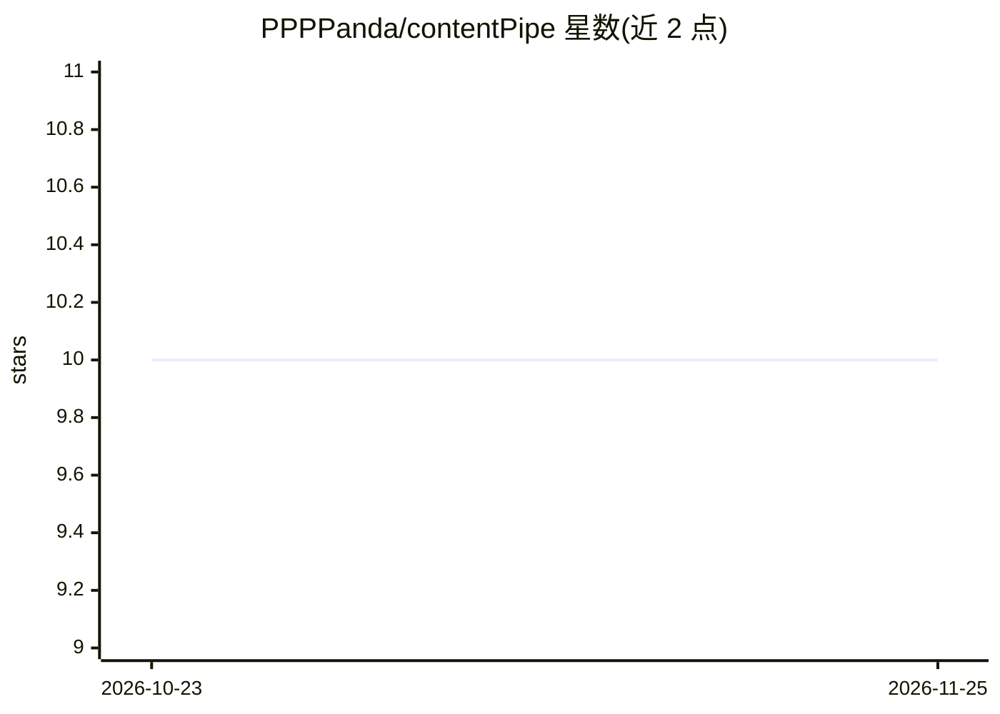

# PPPPanda/contentPipe

⭐ 10 · Python · MIT · 推送 2026-04-06 · [GitHub](https://github.com/PPPPanda/contentPipe) · 个人维护 · 中文 README

**面向微信公众号运营者的 AI 图文内容生产流水线**

基于 OpenClaw 插件形态的公众号内容生产系统，把一篇内容拆为 Scout（选题）、Researcher（事实核查）、Writer（成稿）、Director（配图规划）、Image Gen（生图）、Formatter（排版）、Publisher（发布）七个节点，每节点支持暂停审核、对话修改、重跑与断点续跑。LLM 调用经 OpenClaw Gateway 的 chatCompletions 端点，节点产物由 Python 逐轮读回做提交仲裁。发布默认写入公众号草稿箱，未配置 WECHAT_APPID/SECRET 时仅本地保存。

## 筛选速览

| 维度 | 判定 | 备注 |
|---|---|---|
| AI 角色 | `ai-native` | 本体是模型或模型工具 |
| 许可风险 | `permissive` | MIT |
| 部署形态 | `library` | 以包/库形式分发 |
| 模型依赖 | — | README 未给出锁定关系 |
| 硬件要求 | — | 无带数字的原话,不猜 |
| 安装摩擦 | `low` | 无编译、无系统依赖或容器化 |
| 成熟度 | — | 结构信号不足 |

## 能力要点

- 7 节点流水线覆盖选题到发布，每节点可审核、对话改稿、重跑、断点续跑
- blank-agent 执行平面：每节点独立 session，Python 逐轮读回产物做提交仲裁
- Web 控制台提供 63 个 API 端点、审核页、排版预览与 Setup 向导
- 默认发布目标为公众号草稿箱，支持飞书/Discord/KOOK/企微通知

## 适用场景

- 批量生产公众号图文并通过草稿箱审核后发布
- 在 Web 审核页逐节点修改选题、正文与配图方案
- 把 Markdown 排版为适配公众号深浅色模板的 HTML
- 配合 systemd 将内容流水线部署为常驻后台服务

## 场景标签

`AI 写作` `工作流自动化` `图像生成` · 领域:效率与自动化

## 证据(README 行号)

> L3: > AI 图文内容生产流水线：从选题、调研、写作、配图、排版到发布，全流程可视化、可审核、可回退。
> L42: - LLM 调用：通过 OpenClaw Gateway
> L59: |Writer|连续主 session 负责写稿/追问/改稿；fresh 结构 LLM 负责整理正文、反 AI 对抗与正式落盘，Python 做最终提交仲裁|✅|

## 星数曲线

2026-10-23 10 → 2026-11-25 10（+0）

---
*卡片 v1 · prompt 1.4 · 生成 2026-11-20 · 置信度 mid · 依据 README sha `bf3f4afe7910` · [字段定义](../../DATASET.md)*
