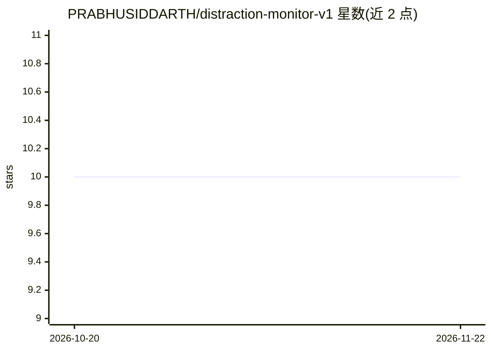

# PRABHUSIDDARTH/distraction-monitor-v1

⭐ 10 · Python · MIT · 推送 2026-05-07 · [GitHub](https://github.com/PRABHUSIDDARTH/distraction-monitor-v1) · 个人维护

**给个人用户的实时屏幕短视频检测与专注提醒工具**

本地运行的注意力监控工具：定时用 mss 抓取屏幕，TensorFlow/Keras 训练的 CNN 将截图分类为 short/reel/non_short 三类，检测到短视频时递增计数，达到用户自设阈值后发出视觉与声音提醒。Flask 后端提供网页仪表盘，可查看分心次数、设置阈值、启停监控、调整扫描间隔。模型文件不随仓库分发，需自行放置 .keras 文件；支持 pip 安装依赖或 Docker Compose 运行。

## 筛选速览

| 维度 | 判定 | 备注 |
|---|---|---|
| AI 角色 | `ai-native` | 本体是模型或模型工具 |
| 许可风险 | `permissive` | MIT |
| 部署形态 | `self-host` | docker 或自建部署 |
| 模型依赖 | — | README 未给出锁定关系 |
| 硬件要求 | — | 无带数字的原话,不猜 |
| 安装摩擦 | `low` | 无编译、无系统依赖或容器化 |
| 成熟度 | — | 结构信号不足 |

## 能力要点

- mss 实时截屏，CNN 分类 short/reel/non_short 三类
- 阈值触发的视觉+声音提醒，计数可查
- Flask 网页仪表盘控制启停与扫描间隔
- Docker Compose 一键启动，模型目录只读挂载

## 适用场景

- 提醒自己别再刷 Reels 和 Shorts
- 统计每天被短视频打断的次数
- 按自设阈值控制分心上限

## 场景标签

`目标检测` · 领域:感知与多模态

## 证据(README 行号)

> L19: Distraction Monitor uses a **custom-trained CNN model** to classify your screen content every few seconds. The mome
> L24: - 🤖 **CNN classifier** trained on custom dataset: `short`, `reel`, `non_short`

## 星数曲线

2026-10-20 10 → 2026-11-22 10（+0）

---
*卡片 v1 · prompt 1.4 · 生成 2026-11-20 · 置信度 high · 依据 README sha `e7f7d70fac6d` · [字段定义](../../DATASET.md)*
