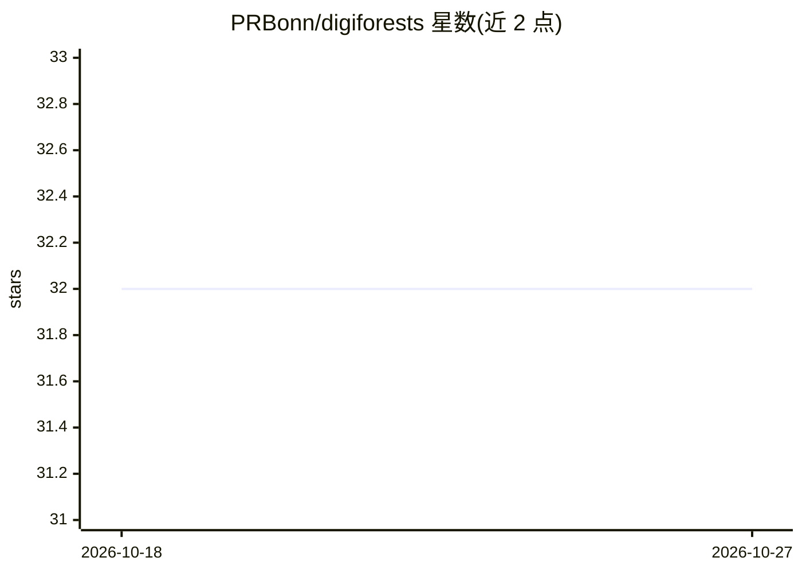

# PRBonn/digiforests

⭐ 32 · Python · MIT · 推送 2026-04-28 · [GitHub](https://github.com/PRBonn/digiforests) · [官网](https://www.ipb.uni-bonn.de/data/digiforest-dataset/) · 组织维护

**森林 LiDAR 数据集开发套件：数据处理与全景分割训练工具**

波恩大学等发布的 DigiForests 数据集配套开发套件。数据集提供背包移动测量系统与航拍系统采集的 LiDAR 点云，含树木、灌木、地面的语义标注、树木实例标注及树干/树冠细粒度语义。套件提供数据加载工具、全景分割模型训练与评估脚本、树木胸径（DBH）估算脚本，并配套 Codabench 挑战赛的隐藏测试集评测。需 CUDA 11.8 与 PyTorch 2.2.1，提供 Docker 容器环境，MIT 许可。

## 筛选速览

| 维度 | 判定 | 备注 |
|---|---|---|
| AI 角色 | `ai-knowledge` | 知识聚合/清单类 |
| 许可风险 | `permissive` | MIT |
| 部署形态 | `library` | 以包/库形式分发 |
| 模型依赖 | — | README 未给出锁定关系 |
| 硬件要求 | — | 无带数字的原话,不猜 |
| 安装摩擦 | `medium` | 含编译或系统依赖之一 |
| 成熟度 | — | 结构信号不足 |

## 能力要点

- 背包/航拍双系统采集的森林 LiDAR 点云数据集
- 语义+实例+树干/树冠细粒度标注
- 全景分割模型训练与评估工具
- 树木胸径（DBH）估算脚本

## 适用场景

- 训练与评估森林点云全景分割模型
- 开展林业机器人相关研究
- 估算与验证树木胸径数据

## 场景标签

`目标检测` · 领域:感知与多模态

## 证据(README 行号)

> L9: The DigiForests dataset 🌳 provides LiDAR point clouds collected with a backpack-carried mobile mapping system and ae
> L12: This development kit offers utilities for handling the DigiForests dataset and includes tools for training panoptic

## 星数曲线

2026-10-18 32 → 2026-10-27 32（+0）

---
*卡片 v1 · prompt 1.4 · 生成 2026-10-26 · 置信度 high · 依据 README sha `16a399c48956` · [字段定义](../../DATASET.md)*
