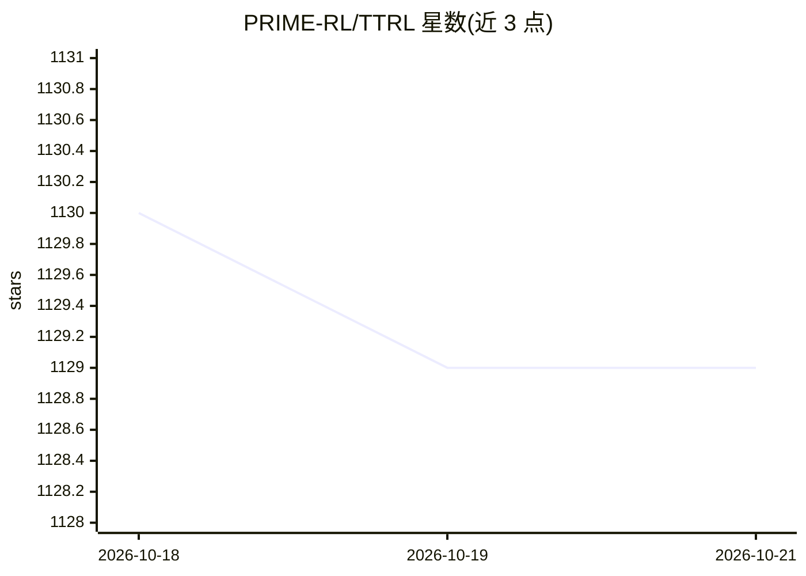

# PRIME-RL/TTRL

⭐ — · [GitHub]() · 组织维护

**在无标签测试数据上对 LLM 做测试时强化学习的研究框架**

NeurIPS 2025 论文 TTRL 的开源实现：研究在无真值标签的数据（尤其是测试数据）上对大语言模型进行在线强化学习，核心机制是用多数投票（maj@n）的结果作为奖励信号驱动训练。实现基于 verl（v0.4.1 起 +ttrl.enable=True 即可启用），提供 Qwen2.5/AIME 2024 等多模型多基准的运行脚本，以及把 JSON 转 Parquet 的数据预处理脚本。面向科研用户复现与扩展测试时训练实验，实验在 8×A100 80GB 上进行。

## 筛选速览

| 维度 | 判定 | 备注 |
|---|---|---|
| AI 角色 | `ai-ecosystem` | LLM/agent 周边工具 |
| 许可风险 | `permissive` | — |
| 部署形态 | `None` |  |
| 模型依赖 | — | README 未给出锁定关系 |
| 硬件要求 | — | 无带数字的原话,不猜 |
| 安装摩擦 | `low` | 无编译、无系统依赖或容器化 |
| 成熟度 | — | 结构信号不足 |

## 能力要点

- 以多数投票（maj@n）作为无标签数据的奖励估计
- 基于 verl 实现，v0.4.1 起可通过 +ttrl.enable=True 启用
- 提供多模型、多基准的复现脚本与数据预处理工具

## 适用场景

- 复现论文中 AIME 2024 等基准的测试时强化学习实验
- 在无标签推理数据上对 LLM 做在线 RL 训练研究
- 基于 verl 修改奖励函数开展自己的方法变体实验

## 场景标签

`强化学习` `科研工具` · 领域:学习与行业

## 证据(README 行号)

> L27: **We investigate Reinforcement Learning (RL) on data without explicit labels for reasoning tasks in Large Language 
> L21: - **[2025-05-23]** We update both the paper and the code, with the implementation based on the verl.
> L20: - **[2025-08-17]** We bump into verl v0.4.1, and now you can enable TTRL by simply setting `+ttrl.enable=True`!

## 星数曲线

2026-10-18 1,130 → 2026-10-21 1,129（-1）

---
*卡片 v1 · prompt 1.4 · 生成 2026-10-21 · 置信度 high · 依据 README sha `a3bcb301f46a` · [字段定义](../../DATASET.md)*
