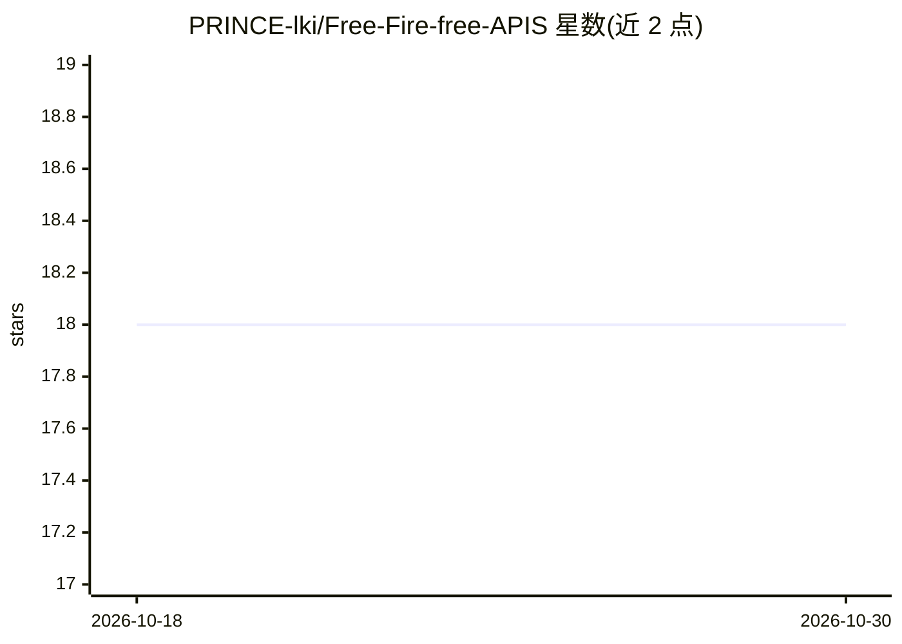

# PRINCE-lki/Free-Fire-free-APIS

⭐ 18 · HTML · NOASSERTION · 推送 2026-04-11 · [GitHub](https://github.com/PRINCE-lki/Free-Fire-free-APIS) · 组织维护

**非官方 Free Fire 玩家信息与战绩查询 API**

面向开发者的 Free Fire 游戏数据 HTTP API，提供三个端点：按用户名/关键词搜索玩家、按 UID 查询 Battle Royale 与 Clash Squad 模式战绩、获取含画廊/黑名单/spark 信息的完整玩家档案，支持 IND/SG/US/BR 等 13 个服务器区域。公开端点无需认证，建议限速每 IP 每分钟 60 次、突发 10 次/秒。声明为非官方项目，与 Garena 无关联，仅供教育用途，API 可能随时停机或变更。README 提供托管实例的 Base URL 与 JavaScript/Python/cURL 调用示例。

## 筛选速览

| 维度 | 判定 | 备注 |
|---|---|---|
| AI 角色 | `ai-ecosystem` | LLM/agent 周边工具 |
| 许可风险 | `none` | NOASSERTION |
| 部署形态 | `None` |  |
| 模型依赖 | — | README 未给出锁定关系 |
| 硬件要求 | — | 无带数字的原话,不猜 |
| 安装摩擦 | `low` | 无编译、无系统依赖或容器化 |
| 成熟度 | — | 结构信号不足 |

## 能力要点

- 三端点：玩家搜索、战绩查询、玩家档案
- 支持 13 个 Free Fire 服务器区域
- 公开端点无需 API key，附 JavaScript/Python/cURL 示例
- 声明非官方：与 Garena 无关联，仅供教育用途

## 适用场景

- 为游戏工具或战绩追踪应用获取玩家数据
- 构建 Free Fire 社区应用或玩家查询工具
- 跨区域查询玩家档案与模式战绩

## 场景标签

 · 领域:游戏数据服务

## 证据(README 行号)

> L16: The **Free Fire Info API** provides developers with programmatic access to Free Fire player data, including search 
> L22: - 🔍 **Player Search**: Find players by username or keyword across multiple regions

## 星数曲线

2026-10-18 18 → 2026-10-30 18（+0）

---
*卡片 v1 · prompt 1.4 · 生成 2026-10-29 · 置信度 mid · 依据 README sha `f779ac4ecdd5` · [字段定义](../../DATASET.md)*
