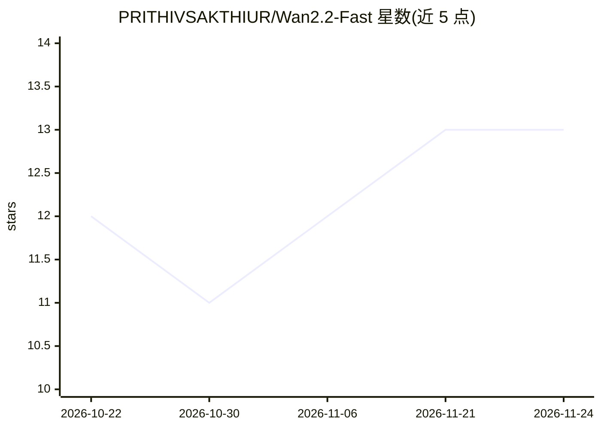

# PRITHIVSAKTHIUR/Wan2.2-Fast

⭐ 13 · HTML · Apache-2.0 · 推送 2026-08-30 · [GitHub](https://github.com/PRITHIVSAKTHIUR/Wan2.2-Fast) · [官网](https://huggingface.co/spaces/prithivMLmods/Wan2.2-Fast) · 个人维护

**基于 Wan2.2 14B 的图像转视频生成套件**

基于 Wan-AI/Wan2.2-I2V-A14B-Diffusers 模型的图像转视频（I2V）生成应用，采用双 3D Transformer 骨干、融合 Lightning 蒸馏 LoRA 与 torchao FP8/Int8 量化，支持 4-6 步推理生成 0.5s-5.0s（16 FPS）视频；通过 FastAPI 与 gradio.Server 提供网页界面，支持拖拽上传、参数调节与 MP4 导出。要求 Python 3.12+、PyTorch 2.11+ 与 CUDA GPU，提供 uv 与 pip 两种安装路径，另有 Hugging Face Space 在线部署。

## 筛选速览

| 维度 | 判定 | 备注 |
|---|---|---|
| AI 角色 | `ai-native` | 本体是模型或模型工具 |
| 许可风险 | `permissive` | Apache-2.0 |
| 部署形态 | `library` | 以包/库形式分发 |
| 模型依赖 | — | README 未给出锁定关系 |
| 硬件要求 | — | 无带数字的原话,不猜 |
| 安装摩擦 | `medium` | 含编译或系统依赖之一 |
| 成熟度 | — | 结构信号不足 |

## 能力要点

- 融合 Lightning LoRA 实现 4-6 步视频推理
- torchao FP8/Int8 量化降低 VRAM 占用
- AOTInductor 编译模块跨 ZeroGPU 环境加载
- FastAPI 驱动的单页 Web 界面，支持历史回放与 MP4 导出

## 适用场景

- 把静态图片生成为短视频片段
- 本地 CUDA GPU 上运行文动提示驱动的图生视频
- 在 Hugging Face Space 上在线体验视频生成

## 场景标签

`视频生成` · 领域:内容生成

## 证据(README 行号)

> L3: Wan2.2-Fast is an optimized, high-performance image-to-video (I2V) generation suite powered by the `Wan-AI/Wan2.2-I2
> L90: Once the FastAPI web server initializes, navigate to your local loopback address (typically `http://127.0.0.1:7860/

## 星数曲线

2026-10-22 12 → 2026-11-24 13（+1）

---
*卡片 v1 · prompt 1.4 · 生成 2026-11-18 · 置信度 high · 依据 README sha `75637fd8eba7` · [字段定义](../../DATASET.md)*
