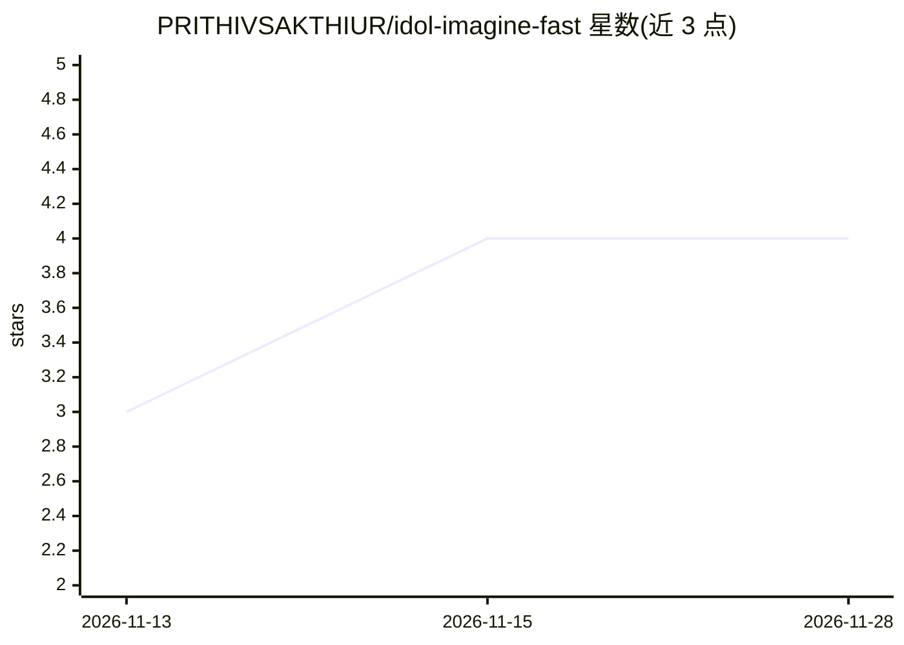

# PRITHIVSAKTHIUR/idol-imagine-fast

⭐ 4 · Python · Apache-2.0 · 推送 2026-11-14 · [GitHub](https://github.com/PRITHIVSAKTHIUR/idol-imagine-fast) · [官网](https://huggingface.co/spaces/prithivMLmods/idol-imagine-fast) · 个人维护

**从文本或单图生成高密度 3D 高斯泼溅的 Gradio 工作台**

双管线应用：文本输入先经 Z-Image-Turbo 9 步生成 2D 概念图，图像输入可直接上传；随后经 BRIA-RMBG-2.0 自动去背景并按主体居中裁剪，再由 Idol 模型重建为 3D 高斯泼溅，输出 .ply 点云文件。提供交互式 3D 查看、5 档高斯数量预设（65,536 至 1,048,576）、Synthetic/Real photo 双条件模式及采样参数调节，内置 130 余个示例。基于 Gradio 构建，支持 ZeroGPU 与 Flash Attention 2。

## 筛选速览

| 维度 | 判定 | 备注 |
|---|---|---|
| AI 角色 | `ai-native` | 本体是模型或模型工具 |
| 许可风险 | `permissive` | Apache-2.0 |
| 部署形态 | `library` | 以包/库形式分发 |
| 模型依赖 | — | README 未给出锁定关系 |
| 硬件要求 | — | 无带数字的原话,不猜 |
| 安装摩擦 | `medium` | 含编译或系统依赖之一 |
| 成熟度 | — | 结构信号不足 |

## 能力要点

- 文本生成图像与图像重建 3D 的端到端双管线
- 5 档高斯密度预设，导出标准 .ply 泼溅文件
- BRIA-RMBG-2.0 自动去背景与主体居中裁剪
- 内置 130 余个图像/文本示例与交互式 3D 查看器

## 适用场景

- 输入一句描述文字生成对应的 3D 泼溅模型
- 上传单张照片重建为可下载的 .ply 三维点云
- 在浏览器中交互查看、缩放并导出生成的 3D 泼溅

## 场景标签

`图像生成` · 领域:内容生成

## 证据(README 行号)

> L3: Idol-Imagine-Fast is a dual-pipeline **Text-to-3D** and **Image-to-3D** generation studio that converts single text 
> L11: * **End-to-End Text-to-3D & Image-to-3D:** Generate a 2D concept image from text in 9 steps via `Tongyi-MAI/Z-Image

## 星数曲线

2026-11-13 3 → 2026-11-28 4（+1）

---
*卡片 v1 · prompt 1.4 · 生成 2026-11-21 · 置信度 high · 依据 README sha `7e24e77f6495` · [字段定义](../../DATASET.md)*
