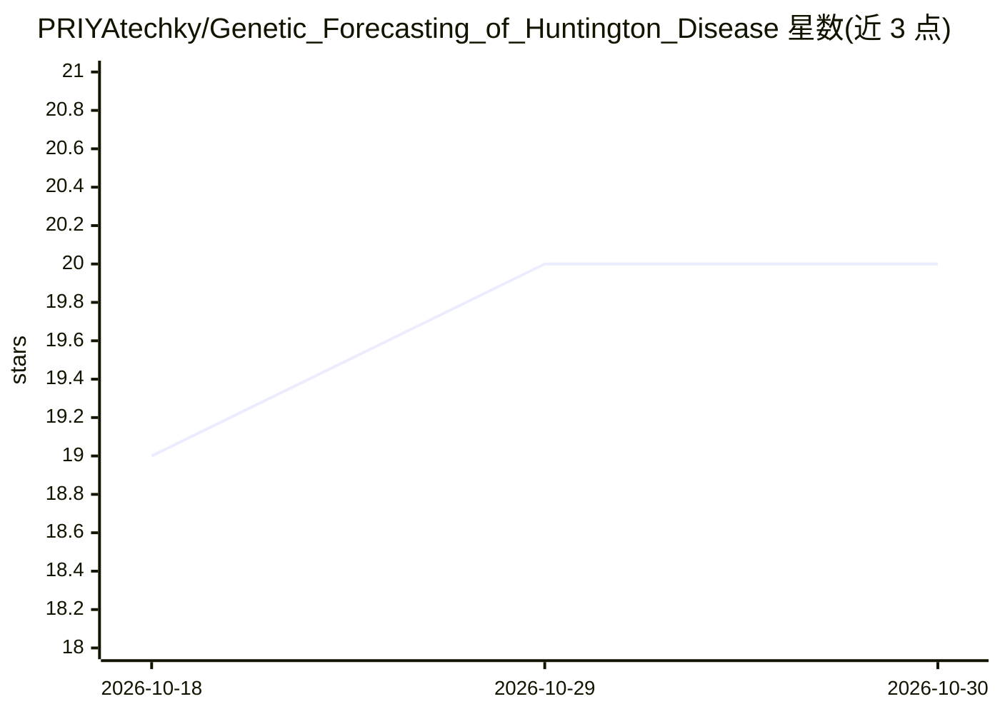

# PRIYAtechky/Genetic_Forecasting_of_Huntington_Disease

⭐ 20 · Python · 推送 2026-06-17 · [GitHub](https://github.com/PRIYAtechky/Genetic_Forecasting_of_Huntington_Disease) · [官网](https://ieeexplore.ieee.org/abstract/document/11541909) · 个人维护

**多模态深度学习框架：融合MRI与基因数据预测亨廷顿病**

面向亨廷顿病早期预测的可解释多模态深度学习框架。模型以 EfficientNet-B3 提取脑部 MRI 图像特征，用图神经网络（GNN）建模 HTT 基因 DNA 序列的遗传关系，经 Transformer 交叉注意力机制融合两种模态后由深度神经网络完成分类；解释性方面使用 SHAP 解释基因组特征、Grad-CAM 可视化 MRI 区域。技术栈为 Python/TensorFlow/Keras，辅以 OpenCV 与 Scikit-learn。README 未提供安装运行命令、数据集获取方式或结果指标。

## 筛选速览

| 维度 | 判定 | 备注 |
|---|---|---|
| AI 角色 | `ai-native` | 本体是模型或模型工具 |
| 许可风险 | `none` | — |
| 部署形态 | `None` |  |
| 模型依赖 | — | README 未给出锁定关系 |
| 硬件要求 | — | 无带数字的原话,不猜 |
| 安装摩擦 | `low` | 无编译、无系统依赖或容器化 |
| 成熟度 | — | 结构信号不足 |

## 能力要点

- EfficientNet-B3 提取 MRI 图像特征
- GNN 建模 HTT 基因序列
- Transformer 交叉注意力融合多模态特征
- SHAP 与 Grad-CAM 提供可解释性

## 适用场景

- 亨廷顿病早期预测研究
- AI 辅助医疗诊断的原型参考
- 多模态（影像+基因）融合建模方法借鉴

## 场景标签

`多模态` · 领域:感知与多模态

## 证据(README 行号)

> L6: This project presents an **Explainable Multimodal Deep Learning Framework** that combines **brain MRI images** and *
> L13: - Explainable AI using SHAP and Grad-CAM
> L34: - Deep Neural Network for disease prediction

## 星数曲线

2026-10-18 19 → 2026-10-30 20（+1）

---
*卡片 v1 · prompt 1.4 · 生成 2026-10-28 · 置信度 mid · 依据 README sha `5fbded7858cd` · [字段定义](../../DATASET.md)*
