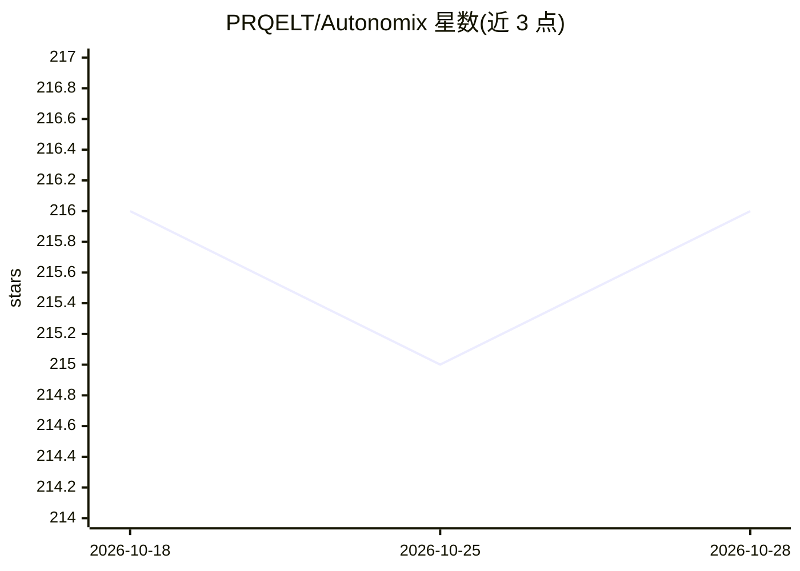

# PRQELT/Autonomix

⭐ 216 · C++ · MIT · 推送 2026-05-08 · [GitHub](https://github.com/PRQELT/Autonomix) · 组织维护

**UE5 编辑器内自主开发项目的 AI agent 插件**

Unreal Engine 编辑器插件，以对话式聊天面板驱动 AI agent 自主创建与修改游戏项目：通过 T3D 注入生成 Blueprint 节点图、编辑 C++ 源码、管理关卡/材质/控件/PCG 等，提供 85+ AI 工具与 agentic 工具循环。支持 Claude、OpenAI、Gemini、DeepSeek、Ollama 等多提供商。含 Git 检查点、安全门禁（风险分级、受保护文件只读）、执行日志与备份等机制；面向在 UE 编辑器内工作的游戏开发者。

## 筛选速览

| 维度 | 判定 | 备注 |
|---|---|---|
| AI 角色 | `ai-native` | 本体是模型或模型工具 |
| 许可风险 | `permissive` | MIT |
| 部署形态 | `None` |  |
| 模型依赖 | local-ok | 支持本地模型 |
| 硬件要求 | — | 无带数字的原话,不猜 |
| 安装摩擦 | `low` | 无编译、无系统依赖或容器化 |
| 成熟度 | — | 结构信号不足 |

## 能力要点

- T3D 单事务注入生成整个 Blueprint 节点图
- 85+ AI 工具覆盖 C++、材质、动画、PCG、行为树等
- 每会话影子 git 仓库检查点，可保存/恢复/对比
- 安全门禁分级评估每次工具调用，受保护文件对 AI 只读

## 适用场景

- 用自然语言让 AI 在 UE 编辑器里直接搭建 Blueprint 和 C++ 功能
- AI 自动运行 PIE 测试并迭代修复自身生成的错误
- 多模型接入（Claude/OpenAI/Gemini/Ollama 等）按任务选择提供商

## 场景标签

`编码 Agent` · 领域:编码与开发

## 证据(README 行号)

> L3:  A production-grade Unreal Engine editor plugin that uses AI to autonomously create, modify, and manage entire game 
> L17: **Autonomix** brings agentic AI capabilities into the Unreal Engine editor. Instead of just generating code snippet
> L30: - **Multi-Provider Support** — Works with Anthropic Claude, OpenAI, Google Gemini, DeepSeek, Mistral, xAI, OpenRout

## 星数曲线

2026-10-18 216 → 2026-10-28 216（+0）

---
*卡片 v1 · prompt 1.4 · 生成 2026-10-22 · 置信度 high · 依据 README sha `bfd016485a59` · [字段定义](../../DATASET.md)*
