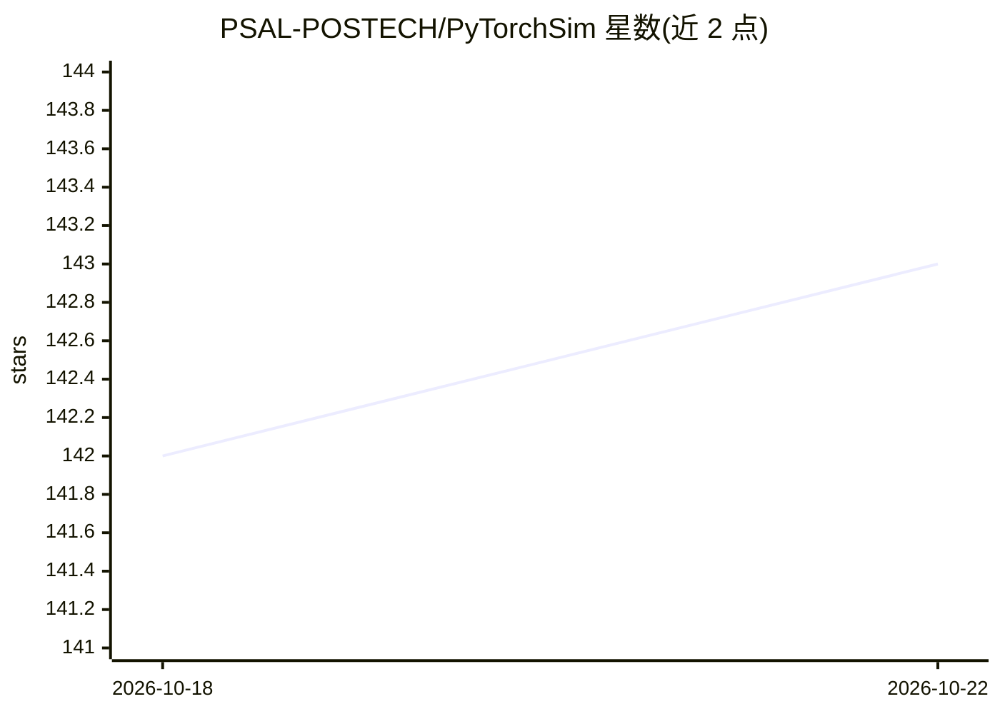

# PSAL-POSTECH/PyTorchSim

⭐ 143 · Python · MIT · 推送 2026-10-21 · [GitHub](https://github.com/PSAL-POSTECH/PyTorchSim) · 组织维护

**给架构研究者的 NPU 仿真框架：在 PyTorch 上跑模型并测硬件性能**

PSAL（POSTECH）开发的 NPU 仿真框架：以 PyTorch2 编译器栈为前端，把 PyTorch 模型编译为基于 RISC-V 向量扩展的 NPU 机器码与 Tile-Operation Graph（TOG），再由 TOGSim 结合 Gem5、Spike、BookSim、Ramulator2 执行高速仿真，输出核心、DRAM、互联等统计。支持推理与训练仿真、数据相关时序建模、多租户调度、编译融合优化、三种映射策略与 L2 持久缓存。提供预构建 Docker 镜像，模型库覆盖 ResNet、Llama 2/3、DeepSeek-V3 等；部分算子（如 DeepSeek 的 gate ops）尚未做周期级建模，Llama-4 支持仍在开发中。

## 筛选速览

| 维度 | 判定 | 备注 |
|---|---|---|
| AI 角色 | `ai-ecosystem` | LLM/agent 周边工具 |
| 许可风险 | `permissive` | MIT |
| 部署形态 | `self-host` | docker 或自建部署 |
| 模型依赖 | — | README 未给出锁定关系 |
| 硬件要求 | — | 无带数字的原话,不猜 |
| 安装摩擦 | `low` | 无编译、无系统依赖或容器化 |
| 成熟度 | — | 结构信号不足 |

## 能力要点

- PyTorch 编译器后端生成 NPU 机器码与 Tile-Operation Graph（TLS 仿真）
- TOGSim 集成 BookSim/Ramulator2 建模 DRAM 与 NoC 共享资源
- 支持推理与训练仿真、数据相关时序（如稀疏性）与多租户调度
- 提供启发式/自动调优/外部工具三种映射策略与 L2 持久缓存

## 适用场景

- 在自定义 NPU 架构上仿真自己 PyTorch 模型的推理与训练性能
- 分析 DRAM 带宽、核心利用率与互联流量等硬件统计
- 用多租户调度与泊松到达生成做 NPU 服务负载实验

## 场景标签

 · 领域:计算机体系结构/硬件仿真

## 证据(README 行号)

> L4: PyTorchSim is a comprehensive, high-speed, cycle-accurate NPU simulation framework.
> L19: - **Compiler**: Integrated with the PyTorch2 compiler stack; it generates NPU machine code and TOG for existing PyT
> L20: - **TOGSim**: Executes TOG for high-speed simulation and accurately models shared resources (DRAM, NoC) through int

## 星数曲线

2026-10-18 142 → 2026-10-22 143（+1）

---
*卡片 v1 · prompt 1.4 · 生成 2026-10-22 · 置信度 high · 依据 README sha `cad4df80e796` · [字段定义](../../DATASET.md)*
