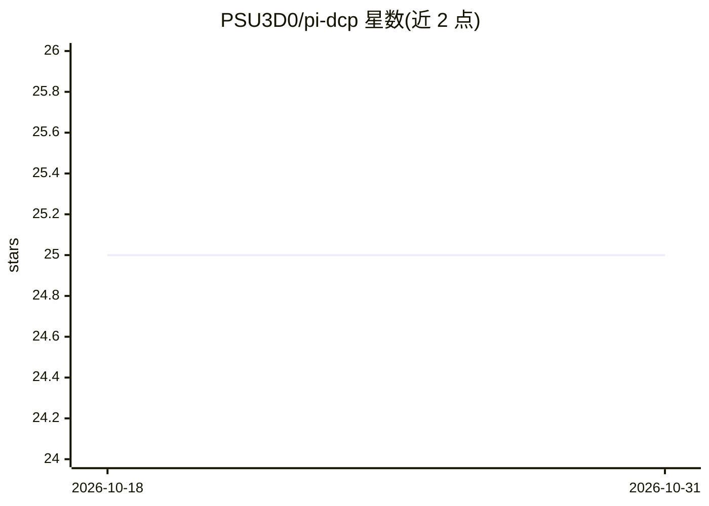

# PSU3D0/pi-dcp

⭐ 25 · TypeScript · 推送 2026-03-06 · [GitHub](https://github.com/PSU3D0/pi-dcp) · [官网](https://coltec.ai) · 个人维护

**Pi 编码代理的上下文剪枝扩展：长会话中削减 token 用量**

面向 Pi Coding Agent 的扩展，作为 Zero-Mutation 上下文钩子运行在 Pi 与 LLM 之间：在每次 API 请求前对消息历史做深拷贝并剪枝，移除重复工具调用、陈旧错误堆栈、被后续 read 覆盖的 write 载荷与老旧大输出，不修改本地会话 JSONL 文件。剪枝策略为纯函数、逆向遍历会话历史，执行耗时约 2 毫秒以内。提供 /dcp 命令查看节省统计与剪枝明细，支持 JSON/JSONC 多级配置，默认 safe 模式并有最近轮次保护。安装通过 pi install git 命令或本地 checkout。

## 筛选速览

| 维度 | 判定 | 备注 |
|---|---|---|
| AI 角色 | `ai-ecosystem` | LLM/agent 周边工具 |
| 许可风险 | `none` | — |
| 部署形态 | `None` |  |
| 模型依赖 | — | README 未给出锁定关系 |
| 硬件要求 | — | 无带数字的原话,不猜 |
| 安装摩擦 | `low` | 无编译、无系统依赖或容器化 |
| 成熟度 | — | 结构信号不足 |

## 能力要点

- 深拷贝上下文子集用于 API 请求，不改动本地会话历史
- 四类剪枝策略：精确去重、错误堆栈缩减、写载荷取代、大输出占位替换
- 策略执行在约 2 毫秒内完成
- 提供 /dcp status/detail 命令与 JSON/JSONC 分层配置（含压力分档）

## 适用场景

- 长编码会话中降低 token 消耗与 API 成本
- 防止大文件读取与堆栈追踪挤爆上下文窗口
- 保留因果历史前提下审计与控制剪枝行为

## 场景标签

 · 领域:开发者工具/LLM 上下文管理

## 证据(README 行号)

> L3: An extension for the Pi Coding Agent that drastically reduces token usage and context bloat during long sessions. It
> L9: DCP solves this by functioning as a "Zero-Mutation Context Hook". It sits between Pi and the LLM, creating a clean, 
> L97: DCP is built using Bun, TypeScript, and the `@mariozechner/pi-coding-agent` SDK.

## 星数曲线

2026-10-18 25 → 2026-10-31 25（+0）

---
*卡片 v1 · prompt 1.4 · 生成 2026-10-27 · 置信度 high · 依据 README sha `3d805686522a` · [字段定义](../../DATASET.md)*
