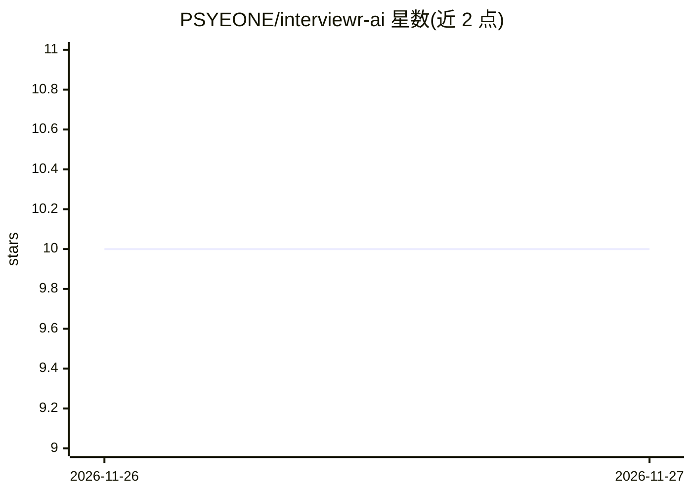

# PSYEONE/interviewr-ai

⭐ 10 · Python · AGPL-3.0 · 推送 2026-11-23 · [GitHub](https://github.com/PSYEONE/interviewr-ai) · 个人维护

**Linux 面试与会议实时转录并生成 AI 提示的本地副驾驶**

面向 Linux 桌面的开源实时副驾驶：用 whisper.cpp（Vulkan 后端，自动 CPU 回退）做本地实时转写，按热键时基于用户 CV、职位描述与对话内容经 RAG 生成流式回答，显示在 Tauri 原生悬浮窗中。默认通过 Ollama 本地运行模型，音频与文档不离开本机；也可切换 Anthropic/OpenAI/Gemini/Groq 或云端语音转写。提供设置向导按显存自动选型下载模型、应用级音频隔离捕获、会话历史与 Markdown/JSON 导出。架构为 Python/FastAPI 引擎加 WebSocket 广播。当前仅支持 Linux/KDE，Windows 与 macOS 在计划中。

## 筛选速览

| 维度 | 判定 | 备注 |
|---|---|---|
| AI 角色 | `ai-native` | 本体是模型或模型工具 |
| 许可风险 | `viral` | AGPL-3.0 |
| 部署形态 | `desktop` | 安装包/桌面程序 |
| 模型依赖 | local-ok | 支持本地模型 |
| 硬件要求 | — | 无带数字的原话,不猜 |
| 安装摩擦 | `low` | 无编译、无系统依赖或容器化 |
| 成熟度 | `idea` | |

## 能力要点

- whisper.cpp Vulkan 后端实时转写，支持 AMD/NVIDIA/Intel GPU 与 CPU 回退
- 默认 Ollama 本地推理，音频与文档不离开本机，可切换云端 API
- 向导读取硬件 VRAM 自动选择并下载 LLM 与语音模型
- 应用级音频隔离捕获与会话历史导出（Markdown/JSON）

## 适用场景

- 面试练习时根据简历与职位描述实时获得提问的回答
- 会议中跟随实时字幕并记录笔记
- 需要音频数据不出本机的隐私场景下做会议转写

## 场景标签

`AI 助手` `RAG` `语音识别` · 领域:对话与助手

## 证据(README 行号)

> L3:  The open-source interview and meeting copilot for Linux.
> L6: - **Live transcription** of your calls with whisper.cpp on your GPU, for rehearsing interviews or following along wi
> L120: A **Python/FastAPI engine** does capture, STT, RAG and LLM orchestration, and broadcasts

## 星数曲线

2026-11-26 10 → 2026-11-27 10（+0）

---
*卡片 v1 · prompt 1.4 · 生成 2026-11-26 · 置信度 mid · 依据 README sha `04e7defa6156` · [字段定义](../../DATASET.md)*
