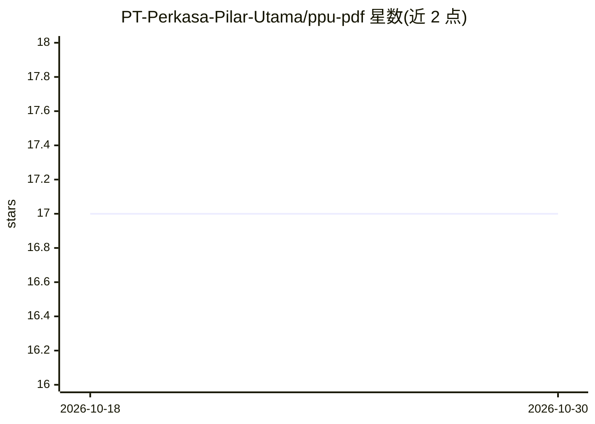

# PT-Perkasa-Pilar-Utama/ppu-pdf

⭐ 17 · TypeScript · MIT · 推送 2026-08-29 · [GitHub](https://github.com/PT-Perkasa-Pilar-Utama/ppu-pdf) · [官网](https://pt-perkasa-pilar-utama.github.io/ppu-pdf/) · 组织维护

**面向开发者的 PDF 文本提取库，支持扫描件 OCR 与画布渲染**

TypeScript/JavaScript 库，提供 PdfReader（基于 mupdfjs）与 PdfReaderLegacy（基于 pdfjs-dist）两个类：提取数字 PDF 文本及坐标/字号数据，合并文本行为完整行，输出 LLM 友好的 TOON 格式（含 bbox）；检测扫描页并渲染为 Canvas/PNG；扫描件文本提取通过可选依赖 ppu-paddle-ocr 完成，还可将扫描 PDF 重建为可搜索 PDF。v6.0.0 起支持浏览器端（PdfReaderLegacyWeb）。OCR 为可选功能，不装 ppu-paddle-ocr 仍可处理数字 PDF。

## 筛选速览

| 维度 | 判定 | 备注 |
|---|---|---|
| AI 角色 | `ai-enhanced` | 去掉 AI 部分产品仍成立 |
| 许可风险 | `permissive` | MIT |
| 部署形态 | `library` | 以包/库形式分发 |
| 模型依赖 | — | README 未给出锁定关系 |
| 硬件要求 | — | 无带数字的原话,不猜 |
| 安装摩擦 | `low` | 无编译、无系统依赖或容器化 |
| 成熟度 | — | 结构信号不足 |

## 能力要点

- 提取文本及 bounding box/字号坐标数据，合并为行
- TOON（Token Object Notation）格式输出，面向 LLM 输入
- 扫描 PDF 检测、Canvas/PNG 渲染与可搜索 PDF 重建
- 浏览器端支持（pdfjs-dist 路径）与 OCR 可选依赖

## 适用场景

- RAG 文档解析管道中提取带坐标的 PDF 文本
- 把扫描 PDF 转成图片或重建为可搜索 PDF
- 在浏览器端读取与提取 PDF 内容

## 场景标签

`文档解析` `OCR` · 领域:知识与检索

## 证据(README 行号)

> L3: Easily extract text from digital PDF and Scanned PDF files with coordinate and font size included, and optionally gr
> L18: - **Scanned PDF Text Extraction:** Retrieve all text content from a scanned PDF using `ppu-paddle-ocr`.
> L74: You can opt-out `ppu-paddle-ocr` if you are planning on not extracting text from scanned pdf.

## 星数曲线

2026-10-18 17 → 2026-10-30 17（+0）

---
*卡片 v1 · prompt 1.4 · 生成 2026-10-30 · 置信度 mid · 依据 README sha `dea388cac1f9` · [字段定义](../../DATASET.md)*
