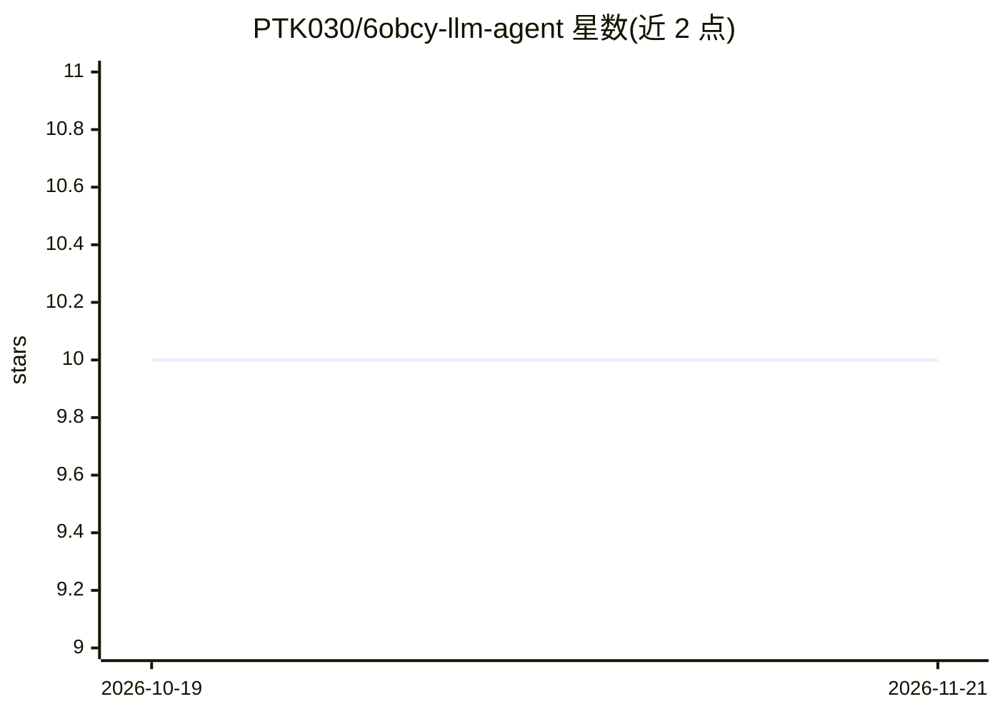

# PTK030/6obcy-llm-agent

⭐ — · [GitHub]() · 个人维护

**在 6obcy.org 匿名聊天网站上自动对话的 AI 机器人**

基于 Selenium WebDriver 的多线程自动化工具，将 LLM 接入波兰匿名聊天平台 6obcy.org。机器人可自动搜索陌生用户、通过 Vision LLM 解图像验证码，并按自定义人设（persona）与目标自动聊天，模拟人类打键速度与错误。采用事件驱动架构与 Page Object Model 模式，提供 TUI 终端界面与运行中热切换配置的聊天命令，支持 Docker 无头运行。README 声明仅用于教育与研究目的，与 6obcy.org 无隶属关系。

## 筛选速览

| 维度 | 判定 | 备注 |
|---|---|---|
| AI 角色 | `ai-native` | 本体是模型或模型工具 |
| 许可风险 | `permissive` | — |
| 部署形态 | `self-host` | docker 或自建部署 |
| 模型依赖 | locked-api |  |
| 硬件要求 | — | 无带数字的原话,不猜 |
| 安装摩擦 | `low` | 无编译、无系统依赖或容器化 |
| 成熟度 | — | 结构信号不足 |

## 能力要点

- Vision LLM（经 OpenRouter）自动读取并绕过图像验证码
- 自定义人设与目标驱动的自动聊天，可模拟人类打键
- 聊天命令热切换模型、API key、人设，无需重启
- Docker + Xvfb 虚拟显示无头运行

## 适用场景

- 在 6obcy.org 上自动化对话实验
- 研究网页自动化与验证码求解流程
- 以不同人设进行聊天机器人行为测试

## 场景标签

`浏览器自动化` `聊天机器人` · 领域:效率与自动化

## 证据(README 行号)

> L16: **6obcy LLM Agent** is an advanced, multi-threaded automation tool that brings Large Language Models (LLMs) to the 
> L25: - 👁️ **Automated CAPTCHA Solving**: Uses advanced Vision LLMs (via OpenRouter) to read and bypass 6obcy's image CAP

## 星数曲线

2026-10-19 10 → 2026-11-21 10（+0）

---
*卡片 v1 · prompt 1.4 · 生成 2026-11-20 · 置信度 high · 依据 README sha `6c4b8444a30a` · [字段定义](../../DATASET.md)*
