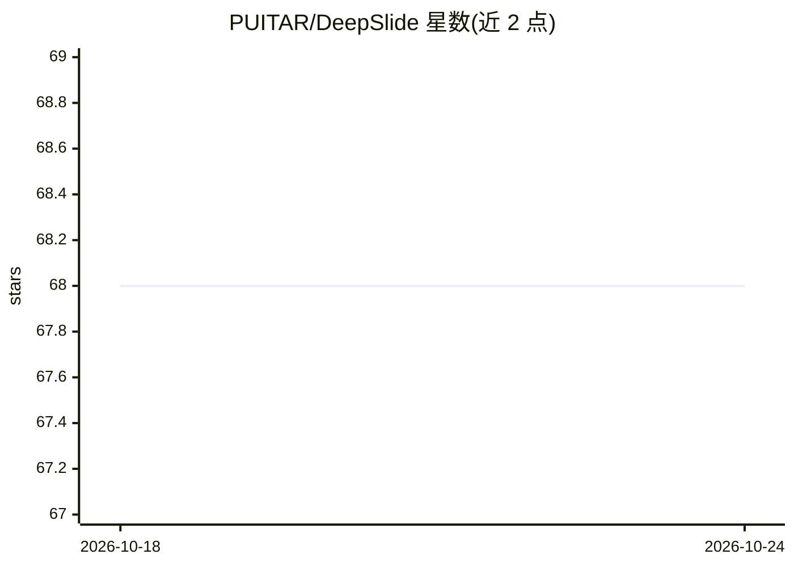

# PUITAR/DeepSlide

⭐ 68 · Python · MIT · 推送 2026-05-20 · [GitHub](https://github.com/PUITAR/DeepSlide) · [官网](https://puitar.github.io/DeepSlide/) · 组织维护 · 中文 README

**面向演讲全流程的人机协作演示准备与演练系统**

面向演讲交付（delivery-first）的 human-in-the-loop 演示准备系统：四阶段流水线——需求澄清与多个时间预算的叙事逻辑链候选、节点级编辑与基于证据的幻灯片+讲稿生成、交互增强（焦点/表格可视化/文转图）、排练与评估（语音预览、观众提问模拟）。运行时由 FastAPI 后端、Vite+React 前端和 next-ai-draw-io 三个服务组成，产出 content.tex 与 speech.txt，可导出 PDF/PPTX。提供 OpenClaw 技能、Docker TeX 环境与实验复现代码；需自备 LLM API（默认 OpenAI），TTS 需另行安装 index-tts。

## 筛选速览

| 维度 | 判定 | 备注 |
|---|---|---|
| AI 角色 | `ai-native` | 本体是模型或模型工具 |
| 许可风险 | `permissive` | MIT |
| 部署形态 | `self-host` | docker 或自建部署 |
| 模型依赖 | — | README 未给出锁定关系 |
| 硬件要求 | — | 无带数字的原话,不猜 |
| 安装摩擦 | `low` | 无编译、无系统依赖或容器化 |
| 成熟度 | — | 结构信号不足 |

## 能力要点

- 四阶段流水线：叙事规划→逻辑链编辑与证据生成→交互增强→排练评估
- 幻灯片与讲稿共交付（content.tex + speech.txt），支持导出 PDF/PPTX
- 双计分板评估（Artifact vs Delivery）及一键复现脚本
- 提供 OpenClaw 技能与 Docker TeX 编译环境（无需本地安装 TeX）

## 适用场景

- 从论文/多文档材料生成带讲稿的完整演讲
- 在排练环节获得语音预览与观众提问模拟反馈
- 按时间预算编辑叙事逻辑链并控制强调分配

## 场景标签

`多模态` `AI 写作` · 领域:内容生成

## 证据(README 行号)

> L5: > DeepSlide is not a tool that simply “makes a PPT for you”, but a **delivery-first, human-in-the-loop system for co
> L44: To this end, DeepSlide proposes a **four-stage end-to-end pipeline**: requirement clarification & narrative proposa
> L92: - `deepslide/backend`: FastAPI (parsing, generation, compilation, export, evaluation entrypoints)

## 星数曲线

2026-10-18 68 → 2026-10-24 68（+0）

---
*卡片 v1 · prompt 1.4 · 生成 2026-10-24 · 置信度 mid · 依据 README sha `d4c3b608d657` · [字段定义](../../DATASET.md)*
