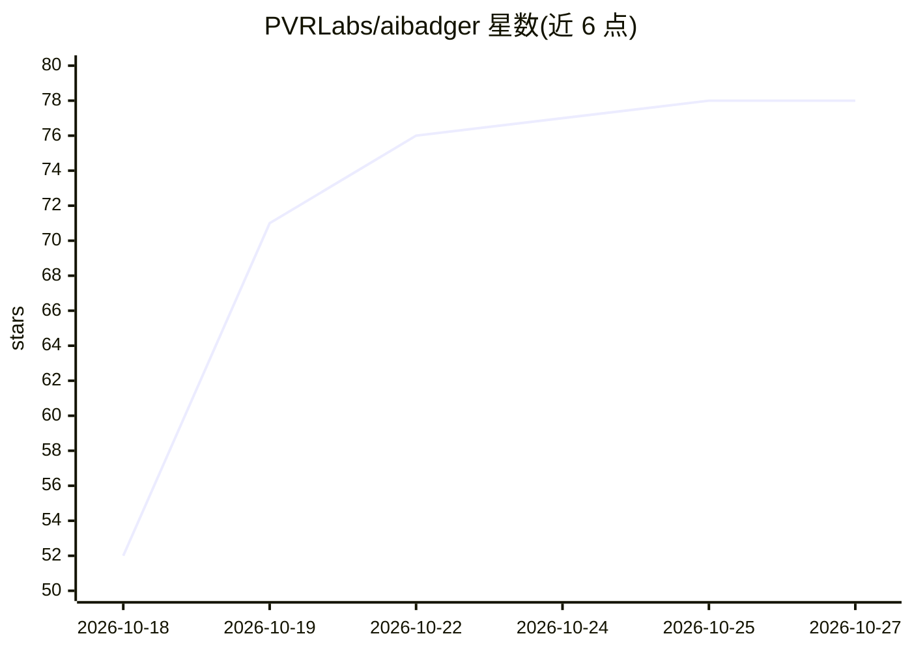

# PVRLabs/aibadger

⭐ 78 · Go · MIT · 推送 2026-10-26 · [GitHub](https://github.com/PVRLabs/aibadger) · [官网](https://pvrlabs.xyz/aibadger/) · 组织维护

**为 AI 聊天准备聚焦仓库上下文的本地 CLI 工具**

用 Go 编写的本地 CLI：通过 Map→Extract 两轮提示流程，根据用户目标生成提示、按 AI 回复索取的文件抓取内容并组装第二份提示，用户手动复制粘贴到任意 AI 聊天（Claude、ChatGPT 等）完成代码评审、设计问答或变更应用，写回需用户确认。全程本地处理，无自动上传、无 API key、无遥测。提供 review/design 专项模式与离线 HTML 代码库地图，附 VS Code 伴侣扩展与 agent skills。

## 筛选速览

| 维度 | 判定 | 备注 |
|---|---|---|
| AI 角色 | `ai-ecosystem` | LLM/agent 周边工具 |
| 许可风险 | `permissive` | MIT |
| 部署形态 | `None` |  |
| 模型依赖 | — | README 未给出锁定关系 |
| 硬件要求 | — | 无带数字的原话,不猜 |
| 安装摩擦 | `low` | 无编译、无系统依赖或容器化 |
| 成熟度 | — | 结构信号不足 |

## 能力要点

- Map→Extract 流程生成分阶段提示，只发送相关文件上下文
- 本地处理、无自动上传、无 API key、无遥测，写操作需用户确认
- badger review / design 专项模式与 badger map 离线代码库 HTML 地图
- 含 handoff、badger-review 两个 agent skills 与 VS Code 伴侣扩展

## 适用场景

- 用日常 AI 聊天对 Git 变更做独立代码评审
- 向 AI 提设计问题时只传相关文件，减少 token 消耗
- 在本地生成代码库结构地图用于浏览

## 场景标签

`代码审查` · 领域:编码与开发

## 证据(README 行号)

> L7: Badger is a local-first repository-context bridge for reviews, design questions, and coding-agent workflows. It prep
> L33: Badger fetches those files and builds a second prompt.

## 星数曲线

2026-10-18 52 → 2026-10-27 78（+26）

---
*卡片 v1 · prompt 1.4 · 生成 2026-10-24 · 置信度 high · 依据 README sha `538fe0e10579` · [字段定义](../../DATASET.md)*
