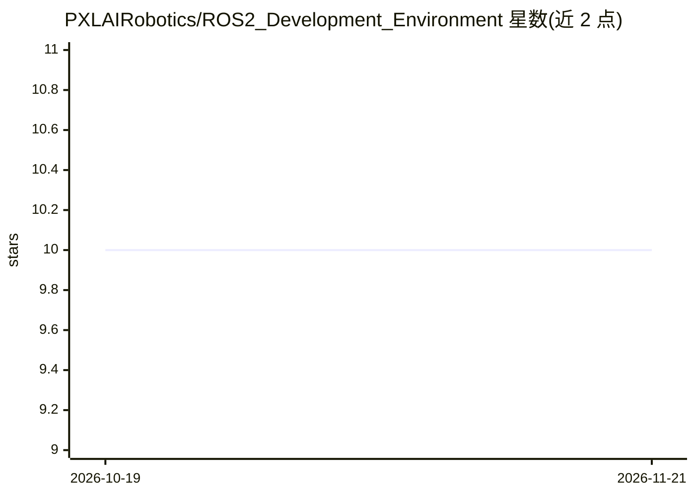

# PXLAIRobotics/ROS2_Development_Environment

⭐ 10 · Shell · NOASSERTION · 推送 2026-10-20 · [GitHub](https://github.com/PXLAIRobotics/ROS2_Development_Environment) · [官网](https://github.com/PXLAIRobotics/ROS2JazzyDocker) · 组织维护

**为 ROS2 Jazzy 提供带远程桌面的 Docker 开发环境**

提供预装 ROS2 Jazzy 的 Ubuntu 24.04 Docker 容器，内置 KasmVNC，可通过 HTTPS 在浏览器中访问 Xfce 桌面运行仿真与其他 ROS2 应用。附一组脚本完成镜像构建、容器运行、Bash 附着、停止与删除；另提供 novnc 镜像在宿主 X11 桌面直接打开应用，以及面向 Windows 用户的 VMware 预建虚拟机方案。支持 NVIDIA GPU 硬件加速（可选），提供 Gazebo、RViz、OpenCV 示例验证，需约 16 GB 磁盘空间。

## 筛选速览

| 维度 | 判定 | 备注 |
|---|---|---|
| AI 角色 | `ai-enhanced` | 去掉 AI 部分产品仍成立 |
| 许可风险 | `none` | NOASSERTION |
| 部署形态 | `self-host` | docker 或自建部署 |
| 模型依赖 | — | README 未给出锁定关系 |
| 硬件要求 | — | 无带数字的原话,不猜 |
| 安装摩擦 | `low` | 无编译、无系统依赖或容器化 |
| 成熟度 | — | 结构信号不足 |

## 能力要点

- 预装 ROS2 Jazzy 的 Ubuntu 24.04 Docker 容器，KasmVNC 经 HTTPS 访问 Xfce 桌面
- 脚本化管理镜像与容器（构建/运行/附着/停止/删除），含 novnc 与 VMware VM 备选路径
- 可选 NVIDIA GPU 加速，附 setup_nvidia_docker.sh 一键配置 Container Toolkit
- 内置 Gazebo/RViz/OpenCV 示例用于环境验证

## 适用场景

- 为机器人课程或工作坊提供统一的 ROS2 开发环境
- 在浏览器远程桌面中运行 Gazebo 仿真
- 在没有本地 ROS2 安装的机器上运行 RViz 与示例节点

## 场景标签

 · 领域:机器人/开发环境

## 证据(README 行号)

> L3: This repository provides a Docker container for ROS2 Jazzy that includes **KasmVNC**, allowing users to access the X
> L8: - **Ubuntu 24.04 Docker container** with **ROS2 Jazzy** pre-installed.

## 星数曲线

2026-10-19 10 → 2026-11-21 10（+0）

---
*卡片 v1 · prompt 1.4 · 生成 2026-11-20 · 置信度 high · 依据 README sha `4b0b3b1ba307` · [字段定义](../../DATASET.md)*
