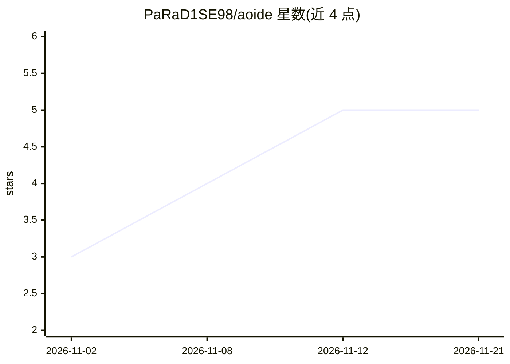

# PaRaD1SE98/aoide

⭐ 5 · Rust · MIT · 推送 2026-11-10 · [GitHub](https://github.com/PaRaD1SE98/aoide) · [官网](https://parad1se98.github.io/aoide/) · 个人维护 · 中文 README

**本地按键说话的语音输入工具，替代 Typeless/Wispr Flow**

Aoide 是 Windows/macOS 桌面语音打字应用：按住热键说话，本地模型转写后直接粘贴到焦点输入框。转写默认用 SenseVoice（经 sherpa-onnx，纯 CPU），也可选 Whisper 模型（Windows 经 Vulkan、Apple silicon 经 Metal 用 GPU）。可选接入任意 OpenAI 兼容 API 做文本润色、语音改写与语音翻译；支持词汇自学习（改错一次即记住）、上下文感知插入、三语界面。以安装包分发，模型从 Hugging Face 下载，无需账号与云服务。

## 筛选速览

| 维度 | 判定 | 备注 |
|---|---|---|
| AI 角色 | `ai-native` | 本体是模型或模型工具 |
| 许可风险 | `permissive` | MIT |
| 部署形态 | `desktop` | 安装包/桌面程序 |
| 模型依赖 | — | README 未给出锁定关系 |
| 硬件要求 | — | 无带数字的原话,不猜 |
| 安装摩擦 | `high` | 编译与系统依赖俱全 |
| 成熟度 | — | 结构信号不足 |

## 能力要点

- 本地转写（SenseVoice/sherpa-onnx 或 whisper.cpp，Vulkan/Metal GPU 加速）
- 热键驱动的听写、取消、语音改写与语音翻译四类操作
- 误识别词一次纠正即加入个人词汇表，后续自动替换
- 语音识别可切换为 OpenAI 兼容 speech-to-text API（含本地服务）

## 适用场景

- 在任意输入框按热键说话即可打字，不联网上传音频
- 长段口述后让 LLM 去掉口头语并整理成条理化文本
- 选定一段文字用语音指令改写或口译成另一语言
- 经常被转错的人名/术语纠正一次后永久生效

## 场景标签

`语音识别` · 领域:感知与多模态

## 证据(README 行号)

> L21: Aoide is a voice typing app for Windows and macOS, an open-source alternative to commercial tools such as Typeless 
> L23: Your speech is transcribed on your own machine with SenseVoice (via sherpa-onnx) or whisper.cpp (GPU-accelerated th

## 星数曲线

2026-11-02 3 → 2026-11-21 5（+2）

---
*卡片 v1 · prompt 1.4 · 生成 2026-11-21 · 置信度 mid · 依据 README sha `62b13f6ebf1f` · [字段定义](../../DATASET.md)*
