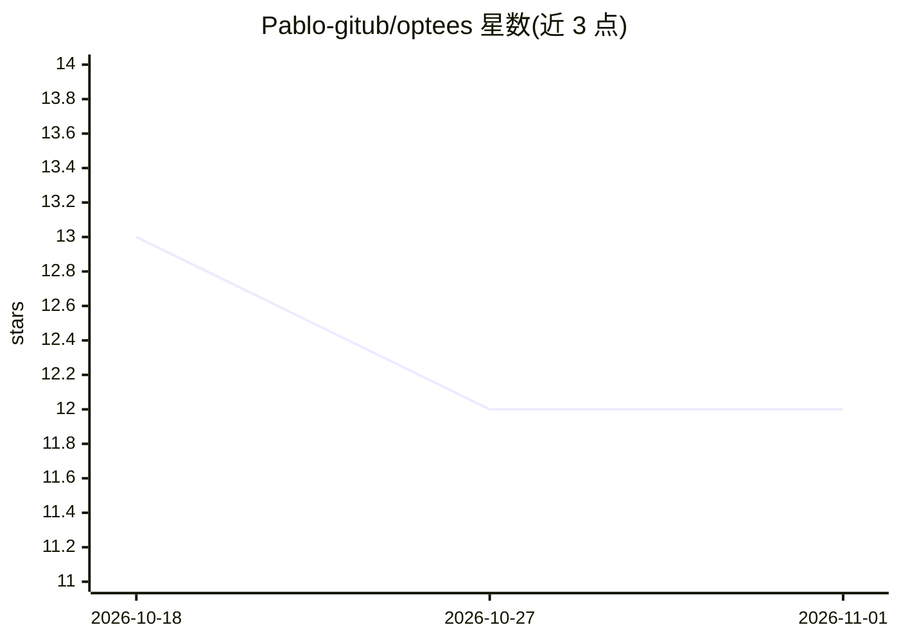

# Pablo-gitub/optees

⭐ 12 · Mathematical Programming System · Apache-2.0 · 推送 2026-10-11 · [GitHub](https://github.com/Pablo-gitub/optees) · [官网](https://optees.it) · 个人维护

**本地数学优化桌面工作台，供人、脚本与 AI agent 使用**

面向优化问题的本地桌面应用与求解器平台：桌面端提供 LP（SciPy/HiGHS）、MILP（OR-Tools）、QP、背包、3D 装箱、NLP、图论、回归/分类/预测等工作流，可视化求解结果；同一求解核心通过 CLI、认证的本地 REST 与 MCP stdio 服务器暴露 16 个版本化能力，供脚本与兼容 AI agent（如 Claude Desktop、实验性 Ollama harness）发现、校验并执行求解任务。内置双语建模助手为规则式、无 LLM 依赖。macOS/Windows/Linux 提供预编译安装包，也可从源码运行（Python 3.12+，Conda 环境）。定位为教育与决策支持工具，明确声明不保证模型适用于重大现实决策。

## 筛选速览

| 维度 | 判定 | 备注 |
|---|---|---|
| AI 角色 | `ai-enhanced` | 去掉 AI 部分产品仍成立 |
| 许可风险 | `permissive` | Apache-2.0 |
| 部署形态 | `library` | 以包/库形式分发 |
| 模型依赖 | — | README 未给出锁定关系 |
| 硬件要求 | — | 无带数字的原话,不猜 |
| 安装摩擦 | `low` | 无编译、无系统依赖或容器化 |
| 成熟度 | `idea` | |

## 能力要点

- 同一求解核心提供 GUI/CLI/REST/MCP 四种接口，16 个版本化能力
- agent 需先检查描述符并校验载荷才可执行求解作业
- 规则式双语建模助手，无 LLM 与云端依赖，数据不出本机
- 结果为结构化 JSON，可选生成带溯源与 SHA-256 的表格/图表/PDF 报告

## 适用场景

- 在桌面端可视化建模并求解 LP/MILP 等优化问题
- 让本地 AI agent 通过 MCP 编排多个求解能力完成复合工作流
- 用脚本经本地 REST API 提交校验过的求解作业并取回结构化结果

## 场景标签

 · 领域:数学优化/决策支持工具

## 证据(README 行号)

> L5:  A local optimization workbench and solver platform for people, software, and AI agents.
> L24: solution, and study the mathematics. Scripts and compatible AI agents can
> L33: |Deterministic bilingual Modeling Assistant with no LLM or cloud dependency|Local agents can compose atomic solvers

## 星数曲线

2026-10-18 13 → 2026-11-01 12（-1）

---
*卡片 v1 · prompt 1.4 · 生成 2026-11-01 · 置信度 mid · 依据 README sha `dfb7eb04635f` · [字段定义](../../DATASET.md)*
