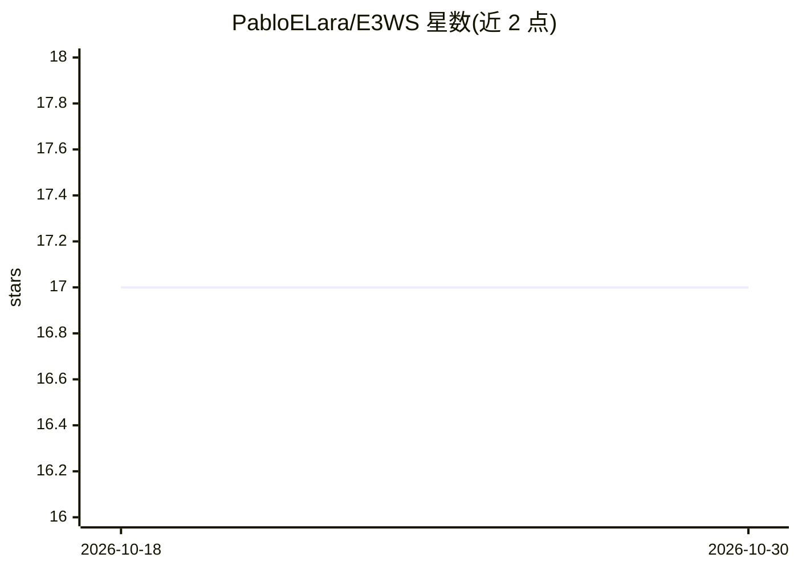

# PabloELara/E3WS

⭐ 17 · Python · CC-BY-4.0 · 推送 2026-04-28 · [GitHub](https://github.com/PabloELara/E3WS) · 个人维护

**单台地震台站的机器学习地震预警系统（3 秒 P 波即估震级）**

面向拥有单个地震台站的科研/监测用户：以 XGBoost 等机器学习模型实现三阶段预警——事件检测、P 震相拾取、震源参数表征（震级与位置）。检测模型需用户用本台站约 10 天连续噪声数据自行训练；拾取与表征模型随仓库附带，可在 P 波到达后 3 秒内给出首次震级估计并随记录持续更新。通过 git clone 源码安装，需自建 Python 3.7-3.9 conda 环境，地震特征向量需另行下载。附带 2022 年利马 M5.6 地震的实时运行示例。

## 筛选速览

| 维度 | 判定 | 备注 |
|---|---|---|
| AI 角色 | `ai-native` | 本体是模型或模型工具 |
| 许可风险 | `viral` | CC-BY-4.0 |
| 部署形态 | `None` |  |
| 模型依赖 | — | README 未给出锁定关系 |
| 硬件要求 | — | 无带数字的原话,不猜 |
| 安装摩擦 | `low` | 无编译、无系统依赖或容器化 |
| 成熟度 | — | 结构信号不足 |

## 能力要点

- 三阶段流程：检测、P 震相拾取、震源表征（震级/位置）
- P 波后 3 秒即可给出首次震级估计并持续收敛更新
- 检测模型可基于台站本底噪声自训练（提供 10 天数据处理脚本）
- 附带实时监测示例（利马 M5.6 地震）

## 适用场景

- 我在单台站上运行实时地震预警与震级估计
- 我想用本台站噪声数据训练定制的检测模型
- 我想复现论文中的实时预警案例

## 场景标签

`科研工具` · 领域:学习与行业

## 证据(README 行号)

> L37: E3WS consists of 3 stages: detection, P-phase picking and source characterization.
> L52: An example of how E3WS works is in the 'real_time/' folder. E3WS detected the M5.6 earthquake of January 7, 2022 in

## 星数曲线

2026-10-18 17 → 2026-10-30 17（+0）

---
*卡片 v1 · prompt 1.4 · 生成 2026-10-30 · 置信度 high · 依据 README sha `110c620feb8b` · [字段定义](../../DATASET.md)*
