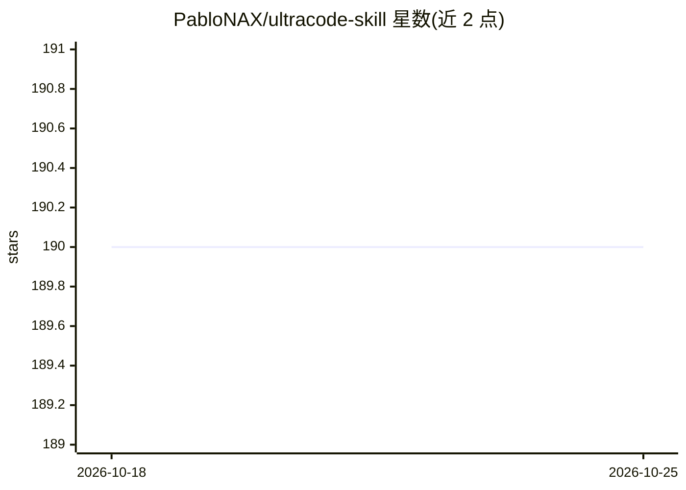

# PabloNAX/ultracode-skill

⭐ 190 · MIT · 推送 2026-06-15 · [GitHub](https://github.com/PabloNAX/ultracode-skill) · 个人维护

**给 Codex 等 AI 编码代理增加动态工作流层的技能包**

以单个 SKILL.md 技能文件夹形式分发的 agent 技能：教会编码代理（主要目标是 Codex，也支持 Claude Code 与 Antigravity）在处理多步编码任务时定义目标与成功标准，选择 Direct/Workflow/Delegated 三种模式，在可用时用原生 spawn_agent 派生 2-4 个侧车代理做独立分包并在父会话中整合，结果以 Markdown/JSON 工作流文件记录便于检查。安装方式为复制 ultracode 文件夹到对应宿主的 skills 目录，不含后台服务或脚本。

## 筛选速览

| 维度 | 判定 | 备注 |
|---|---|---|
| AI 角色 | `ai-ecosystem` | LLM/agent 周边工具 |
| 许可风险 | `permissive` | MIT |
| 部署形态 | `None` |  |
| 模型依赖 | — | README 未给出锁定关系 |
| 硬件要求 | — | 无带数字的原话,不猜 |
| 安装摩擦 | `low` | 无编译、无系统依赖或容器化 |
| 成熟度 | — | 结构信号不足 |

## 能力要点

- 三种模式：Direct 直接编辑 / Workflow 工作流文件 / Delegated 原生代理委派
- 利用 Codex 原生 spawn_agent 派生有界侧车代理（默认不超过 5 个）
- 生成 plan/orchestration/final-report 等可检查的工作流文件
- 单个 SKILL.md 技能文件夹形式，无后台服务、无必需脚本

## 适用场景

- 在 Codex 中端到端完成需要多轮的编码任务
- 需要委派多个独立子任务给原生代理并整合结果
- 希望工作流过程留痕可检查

## 场景标签

`编码 Agent` · 领域:编码与开发

## 证据(README 行号)

> L9: Ultracode Skill gives Codex a dynamic workflow layer for serious coding tasks: planning, native agents, integration,
> L15: Codex is the main target. Claude Code already has first-class workflow concepts; Codex has native multi-agent tools
> L139: Ultracode Skill does not ship a background service, hidden runner, or required scripts. It is a small skill folder

## 星数曲线

2026-10-18 190 → 2026-10-25 190（+0）

---
*卡片 v1 · prompt 1.4 · 生成 2026-10-22 · 置信度 high · 依据 README sha `a4fd4001a3f7` · [字段定义](../../DATASET.md)*
