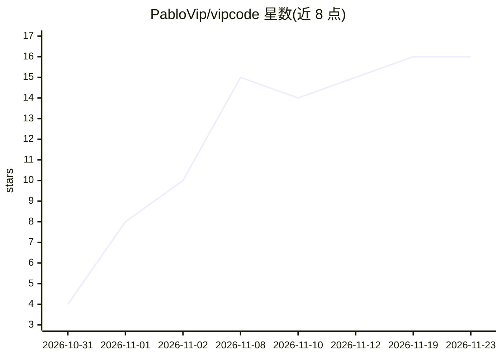

# PabloVip/vipcode

⭐ 16 · TypeScript · AGPL-3.0 · 推送 2026-11-09 · [GitHub](https://github.com/PabloVip/vipcode) · [官网](https://www.npmjs.com/package/vipcode) · 个人维护

**终端编程 AI 代理：免费调用 20+ 提供商并自动切换**

面向终端用户的命令行编程代理，用自然语言指示其读取代码、提出修改、经确认后应用，并可执行命令、跑测试、联网查询。默认无需 API key 即可使用匿名访问的免费提供商（Kilo Gateway、OVHcloud、LLM7、Pollinations），并配 20+ 免费层提供商（Gemini、NVIDIA、Cerebras 等）；模型达到限额、饱和、缓慢或失败时自动切换到下一个，暂停状态跨会话记忆。含 Agent Skills、MCP 服务器、本地模型（Ollama/LM Studio/llama.cpp）支持与教学模式。需 Node.js 22+，仅 Anthropic 为付费例外。

## 筛选速览

| 维度 | 判定 | 备注 |
|---|---|---|
| AI 角色 | `ai-native` | 本体是模型或模型工具 |
| 许可风险 | `viral` | AGPL-3.0 |
| 部署形态 | `self-host` | docker 或自建部署 |
| 模型依赖 | local-ok | 支持本地模型 |
| 硬件要求 | — | 无带数字的原话,不猜 |
| 安装摩擦 | `low` | 无编译、无系统依赖或容器化 |
| 成熟度 | — | 结构信号不足 |

## 能力要点

- 无 key/无注册即装即用 4 个匿名免费提供商，共 20+ 免费提供商
- 按限额/饱和/延迟/故障自动切换模型与整个提供商，暂停跨会话记忆
- 支持 Agent Skills、MCP 服务器、本地模型（Ollama/LM Studio/llama.cpp）与 `vipcode run` 无界面模式
- 编辑/执行/联网前请求确认，`/undo` 撤销文件与对话

## 适用场景

- 在终端用自然语言修复 bug、加功能、解释代码
- 不付费使用多家免费 AI 模型做日常编程
- 用西班牙语界面学习代码修改过程（教学模式）

## 场景标签

`编码 Agent` · 领域:编码与开发

## 证据(README 行号)

> L17: Escribe lo que quieres hacer («arregla el test que falla», «añade un botón de exportar», «explícame este fichero») 
> L21: - **💸 Gratis de verdad.** Solo usa modelos gratuitos: nunca pagas nada (salvo que tú pongas una clave de pago, como

## 星数曲线

2026-10-31 4 → 2026-11-23 16（+12）

---
*卡片 v1 · prompt 1.4 · 生成 2026-11-18 · 置信度 mid · 依据 README sha `47670b2cd7d6` · [字段定义](../../DATASET.md)*
