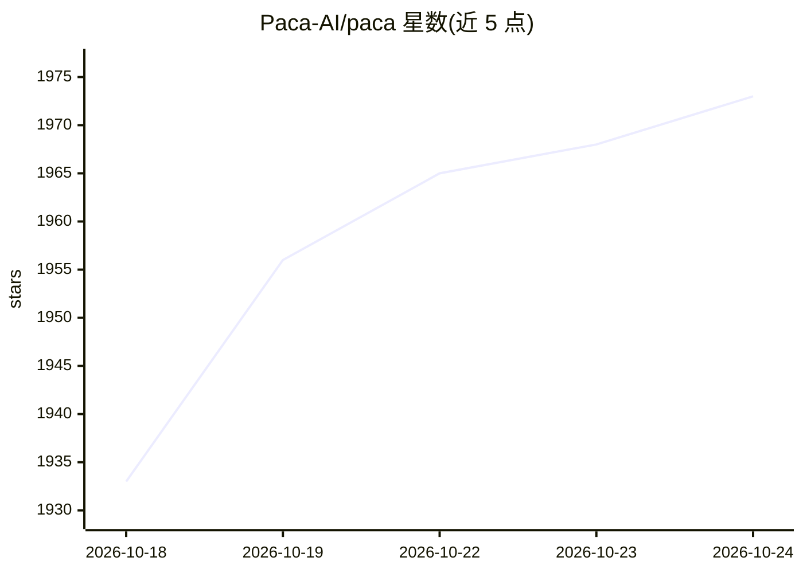

# Paca-AI/paca

⭐ 1,973 · Go · Apache-2.0 · 推送 2026-10-23 · [GitHub](https://github.com/Paca-AI/paca) · [官网](https://paca-ai.org) · 组织维护

**自托管项目管理平台，AI agent 与人类同队协作 Scrum**

Apache 2.0 许可的自托管项目管理平台，定位为 Jira/Trello/ClickUp/Monday 的开源替代。核心设计是让 AI agent 作为一等成员加入 Scrum 团队：出现在 Scrumban 看板、领取任务、协作编写 Gherkin 场景与系统设计文档，并提供项目级 AI 对话。工作流、状态、字段等由配置文件驱动；插件系统后端编译为 WASM（沙箱与能力权限模型），前端为模块包，可从应用内插件市场安装。另含 IAM 式角色权限、事件驱动自动化引擎、静态环境（Docker Compose / Kubernetes+Helm）、MCP Server 与浏览器注释扩展。

## 筛选速览

| 维度 | 判定 | 备注 |
|---|---|---|
| AI 角色 | `ai-enhanced` | 去掉 AI 部分产品仍成立 |
| 许可风险 | `permissive` | Apache-2.0 |
| 部署形态 | `self-host` | docker 或自建部署 |
| 模型依赖 | locked-api |  |
| 硬件要求 | — | 无带数字的原话,不猜 |
| 安装摩擦 | `low` | 无编译、无系统依赖或容器化 |
| 成熟度 | — | 结构信号不足 |

## 能力要点

- AI agent 与人类共享同一 Scrumban 看板并领取任务
- 后端插件以 WASM 沙箱运行，能力式权限模型
- IAM 式角色授权（JSON 策略，默认全拒绝）
- 事件驱动自动化引擎（可视化 Trigger→Condition→Action 流程图）

## 适用场景

- Scrum 团队在同一看板上让人类与 AI agent 协作完成任务
- 自托管并按配置文件定制团队工作流
- 通过 MCP Server 将 Claude 等 agent 接入项目数据层
- 用 BDD 协作让 PO/BA 与 AI 共写 Gherkin 场景

## 场景标签

 · 领域:项目管理/团队协作

## 证据(README 行号)

> L38: Paca is a **self-hosted project management platform** where AI agents and humans collaborate as equal teammates ins
> L171: - **Unified Scrumban Board** — humans and AI agents share a single real-time board; no separate "AI workspace"

## 星数曲线

2026-10-18 1,933 → 2026-10-24 1,973（+40）

---
*卡片 v1 · prompt 1.4 · 生成 2026-10-21 · 置信度 mid · 依据 README sha `62e7a424cd44` · [字段定义](../../DATASET.md)*
