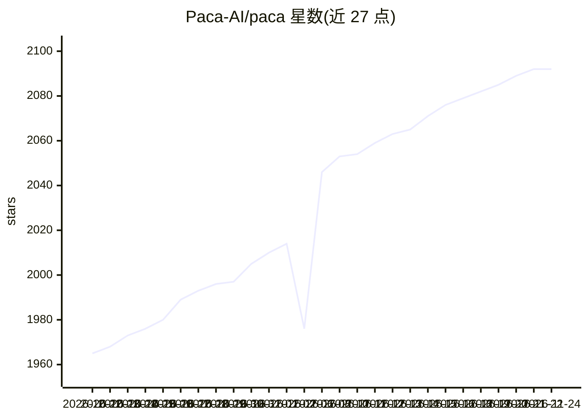

# Paca-AI/paca

⭐ 2,092 · Go · Apache-2.0 · 推送 2026-11-22 · [GitHub](https://github.com/Paca-AI/paca) · [官网](https://paca-ai.org) · 组织维护

**AI 代理与人类同板协作的自托管 Scrum 项目管理平台**

自托管的开源项目管理平台，核心机制是把 AI 代理作为一等队友纳入 Scrum 流程：代理可被分配进 Sprint、从看板领取任务并实时更新状态、协作撰写 BDD/Gherkin 规格与系统设计文档。工作流、状态、字段、看板布局与代理行为均由项目级配置文件驱动，后端插件编译为 WASM 在沙箱中以能力权限模型运行，前端提供插件市场一键安装。平台另含 Git 集成（代理处理 PR）、IAM 式角色授权、MFA 与文档协同编辑。Apache 2.0 许可，声明无付费版本。

## 筛选速览

| 维度 | 判定 | 备注 |
|---|---|---|
| AI 角色 | `ai-enhanced` | 去掉 AI 部分产品仍成立 |
| 许可风险 | `permissive` | Apache-2.0 |
| 部署形态 | `self-host` | docker 或自建部署 |
| 模型依赖 | — | README 未给出锁定关系 |
| 硬件要求 | — | 无带数字的原话,不猜 |
| 安装摩擦 | `low` | 无编译、无系统依赖或容器化 |
| 成熟度 | — | 结构信号不足 |

## 能力要点

- AI 代理作为 Scrum 队友进入看板与 Sprint，领取任务并实时更新状态
- 配置文件驱动的可定制工作流与插件系统（后端 WASM 沙箱 + 能力权限模型，内置插件市场）
- Git 集成：代理可回复、提交、评审并修复 CI，动作以 bot 身份归属
- IAM 式角色授权（JSON 策略、Deny 优先、按资源粒度配置）

## 适用场景

- 自托管管理 Scrum 看板、Sprint 与任务
- 让 AI 代理以队友身份领任务、写 BDD 规格、处理 PR
- 通过插件扩展团队自有工作流与看板视图

## 场景标签

`工作流自动化` `编码 Agent` · 领域:效率与自动化

## 证据(README 行号)

> L45: Paca is a **non-profit, community-driven** project: a **self-hosted project management platform** where AI agents a
> L96: **Plugin system:** extend or replace any part of Paca via plugins. Plugins are compiled to **WebAssembly (WASM)** f
> L55: |**AI integration**|Chatbot add-ons, peripheral automation|AI agents as first-class Scrum teammates|

## 星数曲线

2026-10-22 1,965 → 2026-11-24 2,092（+127）

---
*卡片 v1 · prompt 1.4 · 生成 2026-11-23 · 置信度 low · 依据 README sha `51fb8feeb89d` · [字段定义](../../DATASET.md)*
