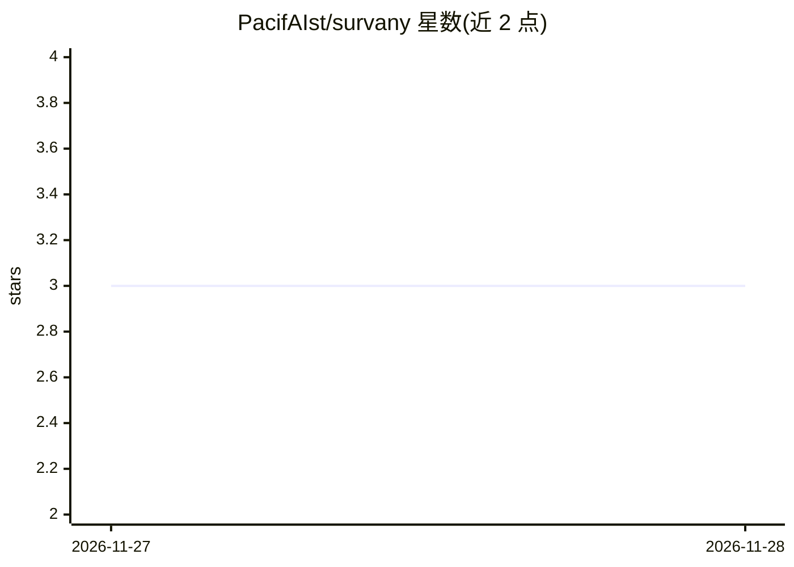

# PacifAIst/survany

⭐ 3 · TypeScript · AGPL-3.0 · 推送 2026-11-24 · [GitHub](https://github.com/PacifAIst/survany) · [官网](https://survany.com) · 组织维护

**浏览器扩展：监控任意标签页或摄像头，人工批准后经 Telegram/邮件告警**

一个 Chrome/Firefox/Edge 扩展，监视浏览器标签页或摄像头画面：每帧先在本机运行免费检测器筛选候选，仅候选帧交由用户自选的 AI 视觉模型确认，命中后经 Telegram 与邮件告警。可选自托管后端（docker compose 分层 T1-T3）提供确认、升级路由、SMTP 邮件、私有直播（OvenMediaEngine）与经 MCP 的设备动作，后者必须人工在 Telegram 点 Approve。内置 11 类 JSON 告警规则模板，支持自定义与分享。无 AI 模型时告警标注 unconfirmed；云模型调用有频次与每日上限。

## 筛选速览

| 维度 | 判定 | 备注 |
|---|---|---|
| AI 角色 | `ai-native` | 本体是模型或模型工具 |
| 许可风险 | `viral` | AGPL-3.0 |
| 部署形态 | `self-host` | docker 或自建部署 |
| 模型依赖 | local-ok | 支持本地模型 |
| 硬件要求 | — | 无带数字的原话,不猜 |
| 安装摩擦 | `low` | 无编译、无系统依赖或容器化 |
| 成熟度 | — | 结构信号不足 |

## 能力要点

- 本地免费检测器先行筛帧，仅候选帧调用 AI 模型确认
- 支持完全本地模型（Ollama/LM Studio/vLLM/llama.cpp）与云模型，配置于 Options 且须通过图像读码探针
- 设备动作经 MCP 链路且须人工在 Telegram 点 Approve；锁具解锁与报警解除默认拒绝
- 告警规则为可分享的 JSON recipe，内置火灾烟雾、入侵、门口包裹等 11 类

## 适用场景

- 离开笔记本时检测是否有人靠近摄像头并推送告警
- 监控 3D 打印、Grafana 面板、商家排队等标签页画面变化
- 自托管后端实现多联系人告警路由与经审批的智能家居动作

## 场景标签

`目标检测` · 领域:感知与多模态

## 证据(README 行号)

> L20: **Point it at any browser tab or camera, say what to watch for, and get a Telegram and email alert when
> L23: A Chrome extension that watches a tab or a camera, runs a free detector on your own computer, asks an AI
> L28: - **Gate, then confirm.** A detector runs on every frame for free; a model is called only on candidates.

## 星数曲线

2026-11-27 3 → 2026-11-28 3（+0）

---
*卡片 v1 · prompt 1.4 · 生成 2026-11-27 · 置信度 high · 依据 README sha `ec0c3f04ef7d` · [字段定义](../../DATASET.md)*
