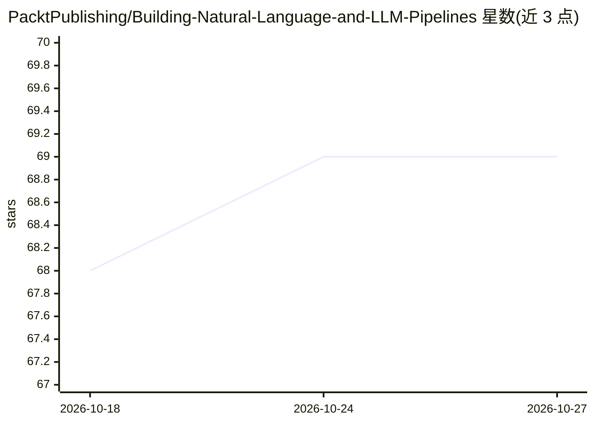

# PacktPublishing/Building-Natural-Language-and-LLM-Pipelines

⭐ 69 · Jupyter Notebook · MIT · 推送 2026-01-01 · [GitHub](https://github.com/PacktPublishing/Building-Natural-Language-and-LLM-Pipelines) · 组织维护

**Packt 图书配套代码：用 Haystack/LangGraph 构建 RAG 与 agent 系统**

《Building Natural Language and LLM Pipelines》的配套代码仓库，作者 Laura Funderburk。内容覆盖 LangGraph 状态化 agent 与多 agent 编排、Haystack 2.0 组件与管道（语义/混合检索、多模态索引）、Ragas 与 Weights & Biases 评估、知识图谱与合成数据生成、FastAPI/Hayhooks/Docker 部署，以及 NER、文本分类、情感分析等实战项目。各章节含 pyproject.toml，通过 uv 安装依赖，Notebook 可在 Colab/Kaggle 等平台打开。

## 筛选速览

| 维度 | 判定 | 备注 |
|---|---|---|
| AI 角色 | `ai-knowledge` | 知识聚合/清单类 |
| 许可风险 | `permissive` | MIT |
| 部署形态 | `self-host` | docker 或自建部署 |
| 模型依赖 | — | README 未给出锁定关系 |
| 硬件要求 | — | 无带数字的原话,不猜 |
| 安装摩擦 | `low` | 无编译、无系统依赖或容器化 |
| 成熟度 | — | 结构信号不足 |

## 能力要点

- LangGraph 状态机、supervisor-worker 多 agent 编排示例
- Haystack 2.0 检索/索引/自定义组件管道，含图像与音频多模态
- Ragas + Weights & Biases 的 RAG 评估与可复现项目
- FastAPI/Hayhooks/Docker 部署为微服务

## 适用场景

- 按章节学习 RAG 管道与多 agent 系统的构建
- 在 Colab/Kaggle 上运行各章配套 Notebook
- 参考将 NER、分类、情感分析封装为 agent 工具的实战项目

## 场景标签

`RAG` `Agent 框架` `多智能体` `教程课程` · 领域:Agent 开发

## 证据(README 行号)

> L2:  This is the code repository for Building Natural Language and LLM Pipelines, First Edition, published by Packt.
> L21: **Develop production-ready NLP and LLM pipelines with Haystack using strict tool contracts, and orchestrate context
> L152: This book guides you through building advanced **Retrieval-Augmented Generation (RAG)** systems and **multi-agent 

## 星数曲线

2026-10-18 68 → 2026-10-27 69（+1）

---
*卡片 v1 · prompt 1.4 · 生成 2026-10-24 · 置信度 mid · 依据 README sha `32cb71f76771` · [字段定义](../../DATASET.md)*
