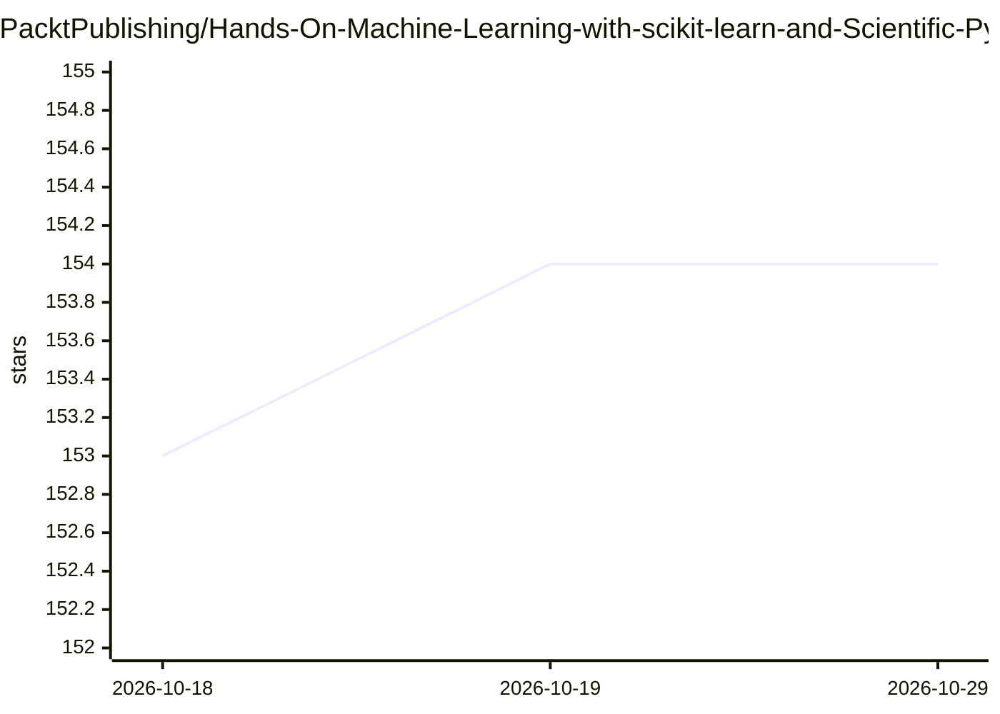

# PacktPublishing/Hands-On-Machine-Learning-with-scikit-learn-and-Scientific-Python-Toolkits

⭐ 154 · Jupyter Notebook · 推送 2026-09-01 · [GitHub](https://github.com/PacktPublishing/Hands-On-Machine-Learning-with-scikit-learn-and-Scientific-Python-Toolkits) · [官网](https://www.packtpub.com/eu/data/hands-on-machine-learning-with-scikit-learn) · 组织维护

**机器学习书籍配套代码库：scikit-learn 实战示例**

Packt 出版书籍《Hands-On Machine Learning with Scikit-Learn and Scientific Python Toolkits》（作者 Tarek Amr）的官方代码仓库，按章节以文件夹组织代码示例，并包含书中省略的代码（如数据可视化样式、额外格式化）。内容覆盖监督/无监督算法、贝叶斯估计、神经网络、树集成、推荐系统、聚类与异常检测，涉及 NumPy、Pandas、SpaCy、imbalanced-learn、Scikit-Surprise 等库。运行需 Python 3.x 与 Jupyter Notebook，提供 conda 环境搭建与 requirements.txt 安装步骤。

## 筛选速览

| 维度 | 判定 | 备注 |
|---|---|---|
| AI 角色 | `ai-knowledge` | 知识聚合/清单类 |
| 许可风险 | `none` | — |
| 部署形态 | `library` | 以包/库形式分发 |
| 模型依赖 | — | README 未给出锁定关系 |
| 硬件要求 | — | 无带数字的原话,不猜 |
| 安装摩擦 | `low` | 无编译、无系统依赖或容器化 |
| 成熟度 | — | 结构信号不足 |

## 能力要点

- 按章节组织的书中代码示例，含书中省略部分
- 覆盖监督/无监督算法、聚类与异常检测等主题
- 涉及 NumPy、Pandas、SpaCy、imbalanced-learn、Scikit-Surprise 等配套库
- 提供 conda 环境创建与 pip 安装依赖的步骤

## 适用场景

- 随书学习 scikit-learn 机器学习算法的实现
- 运行书中各章代码示例复现实验
- 查阅书中省略的数据可视化与格式化代码

## 场景标签

`教程课程` · 领域:学习与行业

## 证据(README 行号)

> L5: This is the code repository for Hands-On Machine Learning with Scikit-Learn and Scientific Python Toolkits, publishe
> L18: In this repo, you will find the code examples used in the book. I also include here parts of the code omitted in th

## 星数曲线

2026-10-18 153 → 2026-10-29 154（+1）

---
*卡片 v1 · prompt 1.4 · 生成 2026-10-22 · 置信度 high · 依据 README sha `6b38b76096d1` · [字段定义](../../DATASET.md)*
