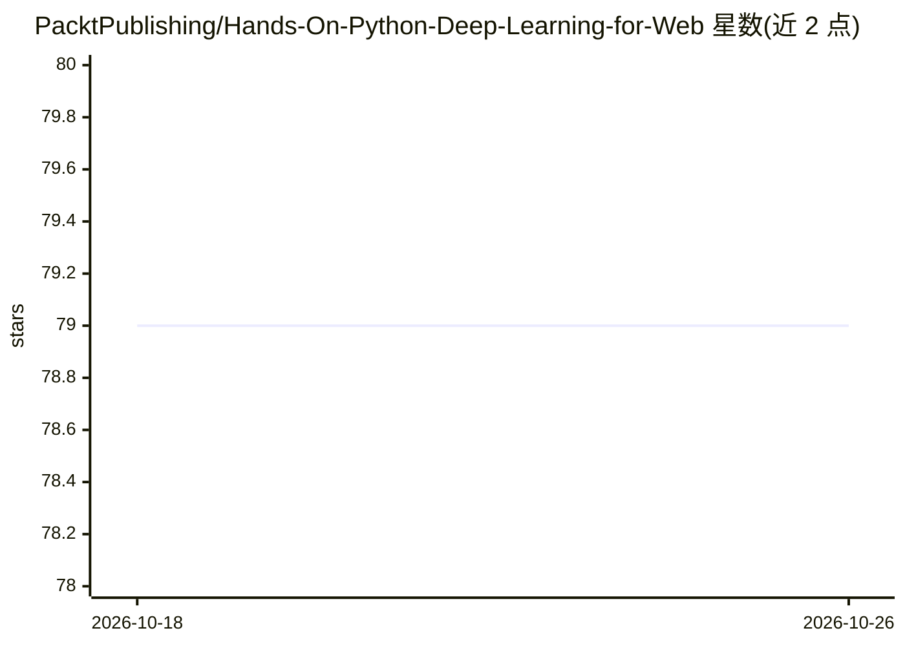

# PacktPublishing/Hands-On-Python-Deep-Learning-for-Web

⭐ 79 · Jupyter Notebook · MIT · 推送 2026-03-02 · [GitHub](https://github.com/PacktPublishing/Hands-On-Python-Deep-Learning-for-Web) · [官网](https://www.packtpub.com/product/hands-on-python-deep-learning-for-the-web/9781789956085) · 组织维护

**《Hands-On Python Deep Learning for Web》一书配套代码仓库**

Packt 出版书籍的代码仓库，内容按章节组织为文件夹（如 Chapter02）。书中内容涵盖深度学习基础与神经网络变体（CNN 等）、用 Django 和 Flask 构建深度学习 Web 应用与 RESTful API、TensorFlow.js 浏览器端模型实现，以及在 Google Cloud 与 AWS 上部署云端深度学习 Web 服务。面向数据科学家、机器学习从业者、深度学习工程师及希望在浏览器中实现智能功能的 Web 开发者，需要 Python 与基础机器学习知识。

## 筛选速览

| 维度 | 判定 | 备注 |
|---|---|---|
| AI 角色 | `ai-knowledge` | 知识聚合/清单类 |
| 许可风险 | `permissive` | MIT |
| 部署形态 | `None` |  |
| 模型依赖 | — | README 未给出锁定关系 |
| 硬件要求 | — | 无带数字的原话,不猜 |
| 安装摩擦 | `low` | 无编译、无系统依赖或容器化 |
| 成熟度 | — | 结构信号不足 |

## 能力要点

- 按章节组织的全书（第 1-12 章）示例代码
- 覆盖 Flask/Django 构建深度学习 RESTful API
- 涵盖 TensorFlow.js 浏览器端模型与 GCP/AWS 云端部署

## 适用场景

- 跟随书籍章节实践深度学习 Web 开发代码
- 学习将神经网络模型集成到 Python Web 技术栈
- 参考云端深度学习部署示例

## 场景标签

`教程课程` · 领域:学习与行业

## 证据(README 行号)

> L5: This is the code repository for Hands-On Python Deep Learning for Web by Anubhav Singh and Sayak Paul, published by 
> L11: Starting with the fundamentals of machine learning, you'll focus on DL and the basics of neural networks, including

## 星数曲线

2026-10-18 79 → 2026-10-26 79（+0）

---
*卡片 v1 · prompt 1.4 · 生成 2026-10-24 · 置信度 high · 依据 README sha `8120bbcaa7d7` · [字段定义](../../DATASET.md)*
