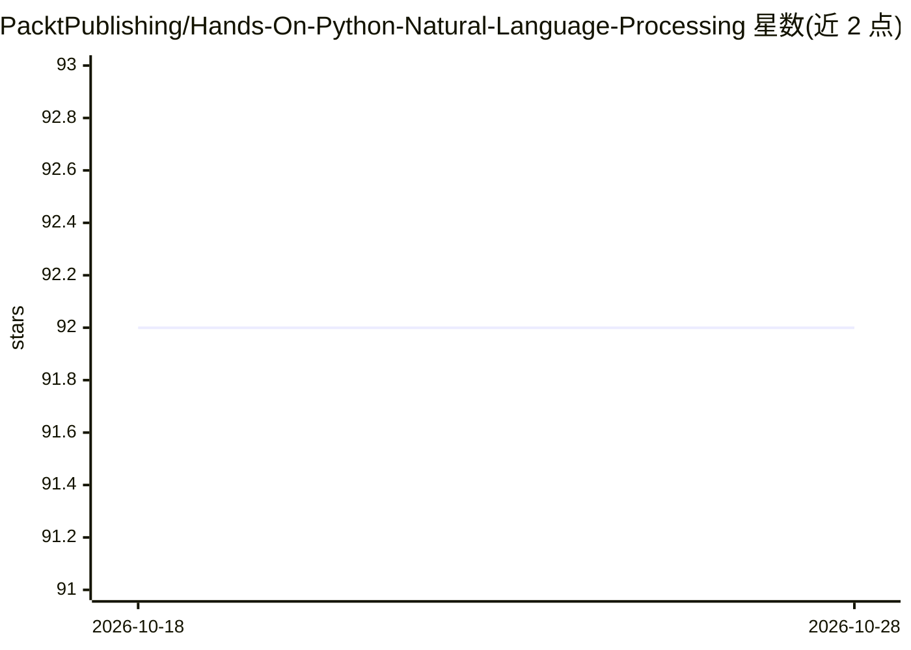

# PacktPublishing/Hands-On-Python-Natural-Language-Processing

⭐ 92 · Jupyter Notebook · MIT · 推送 2026-03-02 · [GitHub](https://github.com/PacktPublishing/Hands-On-Python-Natural-Language-Processing) · 组织维护

**Packt 图书《Hands-On Python NLP》配套代码仓库**

Packt Publishing 出版图书 Hands-On Python Natural Language Processing 的代码仓库，按章节以文件夹组织第 2-11 章代码，内容涵盖 NLP 理论与实践、文本向量化、文本挖掘模型、神经网络架构与文本处理模型构建，示例包括语言翻译与情感分析。面向希望学习 NLP 的读者，要求具备 Python 与高中数学基础；运行环境为 Jupyter Notebook/Google Colab 与 Python 3.x，GPU 为推荐配置。仓库同时提供勘误与配图 PDF。

## 筛选速览

| 维度 | 判定 | 备注 |
|---|---|---|
| AI 角色 | `ai-knowledge` | 知识聚合/清单类 |
| 许可风险 | `permissive` | MIT |
| 部署形态 | `None` |  |
| 模型依赖 | — | README 未给出锁定关系 |
| 硬件要求 | — | 无带数字的原话,不猜 |
| 安装摩擦 | `low` | 无编译、无系统依赖或容器化 |
| 成熟度 | — | 结构信号不足 |

## 能力要点

- 第 2-11 章代码按文件夹组织
- 覆盖文本向量化、文本挖掘、神经网络与深度学习文本处理
- 提供勘误与配图 PDF 下载

## 适用场景

- 跟随图书章节动手运行 NLP 示例代码
- 在 Google Colab 中练习书中的文本处理与深度学习实验

## 场景标签

`教程课程` · 领域:学习与行业

## 证据(README 行号)

> L5: This is the code repository for Hands-On Python Natural Language Processing, published by Packt.
> L10: This book provides a blend of both the theoretical and practical aspects of Natural Language Processing (NLP). It c

## 星数曲线

2026-10-18 92 → 2026-10-28 92（+0）

---
*卡片 v1 · prompt 1.4 · 生成 2026-10-23 · 置信度 high · 依据 README sha `b22ff6ad6ce1` · [字段定义](../../DATASET.md)*
