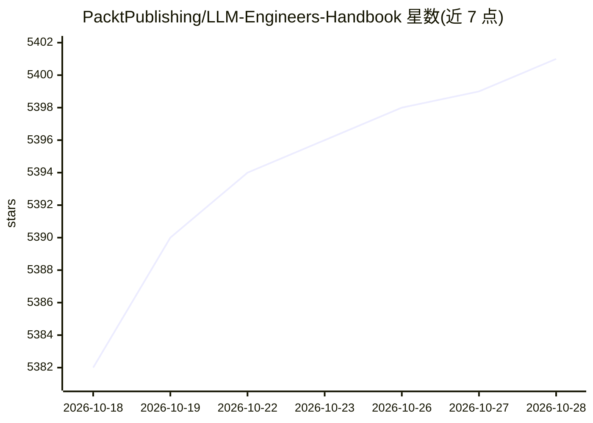

# PacktPublishing/LLM-Engineers-Handbook

⭐ 5,401 · Python · MIT · 推送 2026-04-22 · [GitHub](https://github.com/PacktPublishing/LLM-Engineers-Handbook) · [官网](https://www.amazon.com/LLM-Engineers-Handbook-engineering-production/dp/1836200072/) · 组织维护

**LLM 工程书籍配套代码库：端到端 LLM/RAG 系统与 AWS 部署**

Packt 出版的《LLM Engineer's Handbook》官方仓库，含可运行的完整工程代码：数据采集与生成、LLM 训练流水线、简单 RAG 系统、REST API 推理服务与 AWS 生产部署。代码以 DDD 分层的 Python 包 llm_engineering 为核心，使用 ZenML 编排流水线、Poetry 管理依赖，本地经 Docker 运行 MongoDB 与 Qdrant，云端依赖 HuggingFace 模型注册、Comet/Opik 监控与 AWS SageMaker/ECR/S3。仓库持续维护，可能包含书中未反映的更新。

## 筛选速览

| 维度 | 判定 | 备注 |
|---|---|---|
| AI 角色 | `ai-knowledge` | 知识聚合/清单类 |
| 许可风险 | `permissive` | MIT |
| 部署形态 | `None` |  |
| 模型依赖 | — | README 未给出锁定关系 |
| 硬件要求 | — | 无带数字的原话,不猜 |
| 安装摩擦 | `low` | 无编译、无系统依赖或容器化 |
| 成熟度 | — | 结构信号不足 |

## 能力要点

- 覆盖数据、训练、RAG、推理、AWS 部署的端到端代码
- DDD 分层 Python 包 + ZenML 流水线编排
- 本地 Docker 运行 MongoDB/Qdrant，云端接入 HuggingFace/Comet/Opik/AWS
- 提供训练完成模型在 Hugging Face 上的下载

## 适用场景

- 跟着书籍搭建自己的端到端 LLM/RAG 系统
- 学习 LLMOps 流水线编排与生产部署实践
- 参考 DDD 分层的 LLM 工程代码结构

## 场景标签

`RAG` `微调` `MLOps` `教程课程` · 领域:知识与检索

## 证据(README 行号)

> L2:  Official repository of the LLM Engineer's Handbook by Paul Iusztin and Maxime Labonne
> L13: The goal of this book is to create your own end-to-end LLM-based system using best practices:
> L16: - 🔄 LLM training pipeline

## 星数曲线

2026-10-18 5,382 → 2026-10-28 5,401（+19）

---
*卡片 v1 · prompt 1.4 · 生成 2026-10-20 · 置信度 high · 依据 README sha `0df8f08bc57b` · [字段定义](../../DATASET.md)*
