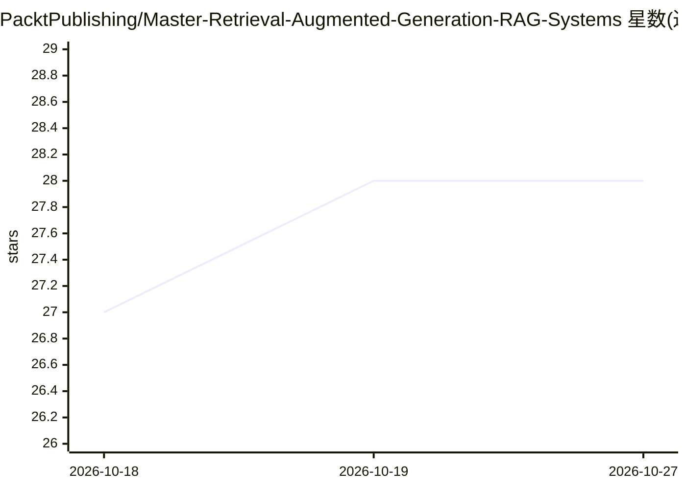

# PacktPublishing/Master-Retrieval-Augmented-Generation-RAG-Systems

⭐ 28 · Python · MIT · 推送 2025-12-15 · [GitHub](https://github.com/PacktPublishing/Master-Retrieval-Augmented-Generation-RAG-Systems) · 组织维护

**Packt 视频课程配套代码库：RAG 系统实现与优化**

Packt 出版的《Master Retrieval-Augmented Generation (RAG) Systems》视频课程的配套代码仓库，包含课程全部支持项目文件。课程内容涵盖朴素与进阶 RAG 技术实现、文档检索与答案生成优化、多查询查询扩展、cross-encoder 与 bi-encoder 重排序、稠密段落检索，以及将进阶 RAG 技术集成到 AI 应用。面向跟随课程动手实践的学习者，README 未给出独立的安装运行命令。

## 筛选速览

| 维度 | 判定 | 备注 |
|---|---|---|
| AI 角色 | `ai-knowledge` | 知识聚合/清单类 |
| 许可风险 | `permissive` | MIT |
| 部署形态 | `None` |  |
| 模型依赖 | — | README 未给出锁定关系 |
| 硬件要求 | — | 无带数字的原话,不猜 |
| 安装摩擦 | `low` | 无编译、无系统依赖或容器化 |
| 成熟度 | — | 结构信号不足 |

## 能力要点

- 课程配套全部项目文件，供从始至终跟练
- 覆盖朴素与进阶 RAG 技术实现
- 包含查询扩展、重排序与稠密段落检索主题

## 适用场景

- 跟随视频课程动手学习 RAG 实现
- 查阅 RAG 检索优化与重排序的示例代码

## 场景标签

`RAG` `教程课程` · 领域:知识与检索

## 证据(README 行号)

> L2: This is the code repository for Master Retrieval-Augmented Generation (RAG) Systems, published by Packt. It contains
> L4: This course offers an in-depth exploration of Retrieval-Augmented Generation (RAG) systems. You’ll start with the ba

## 星数曲线

2026-10-18 27 → 2026-10-27 28（+1）

---
*卡片 v1 · prompt 1.4 · 生成 2026-10-26 · 置信度 high · 依据 README sha `3973ebac24eb` · [字段定义](../../DATASET.md)*
