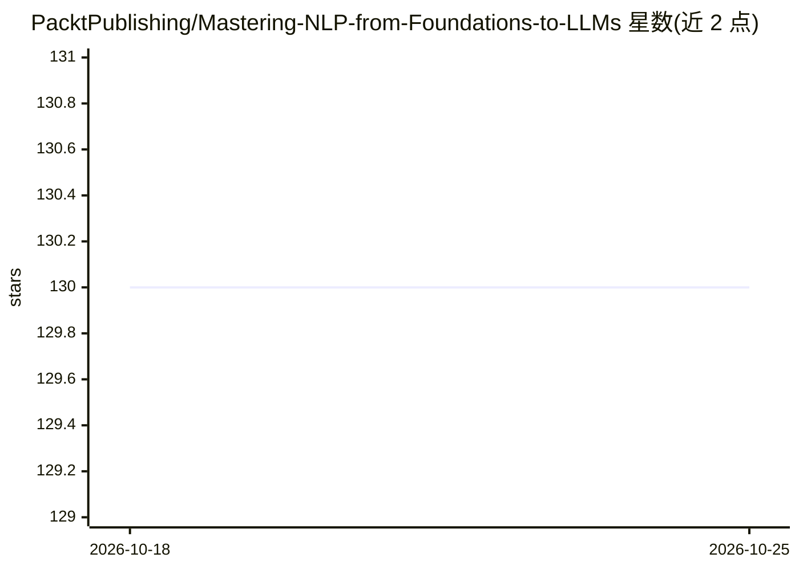

# PacktPublishing/Mastering-NLP-from-Foundations-to-LLMs

⭐ 130 · Jupyter Notebook · MIT · 推送 2026-09-05 · [GitHub](https://github.com/PacktPublishing/Mastering-NLP-from-Foundations-to-LLMs) · 组织维护

**Packt 出版的 NLP 到 LLM 教学图书配套代码库**

图书《Mastering NLP from Foundations to LLMs》的官方代码仓库，由 Packt 出版，内容于 2025 年 4 月重构更新。图书覆盖机器学习数学基础、文本预处理与分类、嵌入技术、LLM 理论与应用，并涉及 LangChain 框架，代码按章节以文件夹组织，全部为 Python 示例。运行环境要求 Google Colab（免费 GPU）或本地/云 Python 环境并支持 OpenAI API 访问。面向深度学习与机器学习研究人员、NLP 从业者、教育者及 STEM 学生，需具备机器学习入门基础和 Python 基础知识。仓库另提示第二版《Mastering NLP From Foundations to Agents》已发布。

## 筛选速览

| 维度 | 判定 | 备注 |
|---|---|---|
| AI 角色 | `ai-knowledge` | 知识聚合/清单类 |
| 许可风险 | `permissive` | MIT |
| 部署形态 | `None` |  |
| 模型依赖 | — | README 未给出锁定关系 |
| 硬件要求 | — | 无带数字的原话,不猜 |
| 安装摩擦 | `low` | 无编译、无系统依赖或容器化 |
| 成熟度 | — | 结构信号不足 |

## 能力要点

- 按章节文件夹组织的全书 Python 代码示例（2025 年 4 月更新）
- 覆盖 ML 数学基础、文本预处理/分类、嵌入技术与 LLM 应用
- 可运行于 Google Colab 免费 GPU 环境

## 适用场景

- 跟随图书章节动手运行 NLP/LLM 示例代码
- 学习从机器学习数学基础到 LLM 应用的完整路径
- 在 Colab 上复现书中业务问题与解决方案

## 场景标签

`教程课程` · 领域:学习与行业

## 证据(README 行号)

> L9: This is the code repository for Mastering NLP from Foundations to LLMs, published by Packt.
> L29: Do you want to master Natural Language Processing (NLP) but don’t know where to begin? This book will give you the 

## 星数曲线

2026-10-18 130 → 2026-10-25 130（+0）

---
*卡片 v1 · prompt 1.4 · 生成 2026-10-22 · 置信度 high · 依据 README sha `b0f8e961c82d` · [字段定义](../../DATASET.md)*
