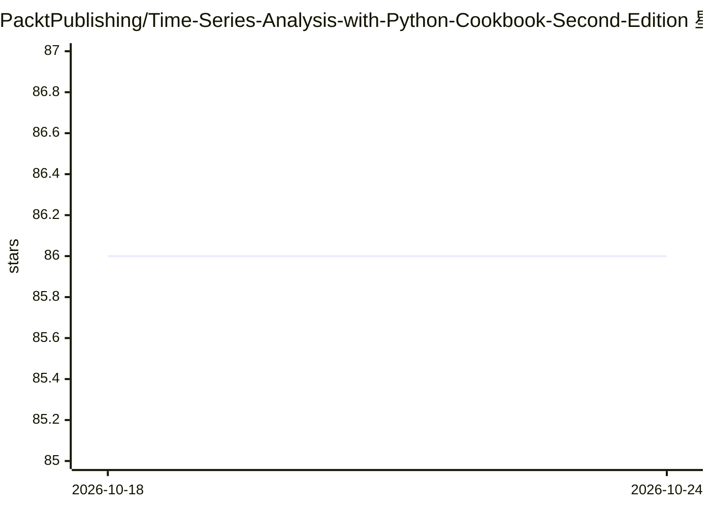

# PacktPublishing/Time-Series-Analysis-with-Python-Cookbook-Second-Edition

⭐ 86 · Jupyter Notebook · MIT · 推送 2026-02-12 · [GitHub](https://github.com/PacktPublishing/Time-Series-Analysis-with-Python-Cookbook-Second-Edition) · 组织维护

**Python 时间序列分析 cookbook 配套代码库（16 章）**

Packt 出版的《Time Series Analysis with Python Cookbook, Second Edition》配套代码仓库，按章节提供 Jupyter notebook，覆盖文件/数据库读写、缺失值处理、统计方法与无监督机器学习的异常检测、监督学习与深度学习预测、概率预测与频域分析等。每章含独立环境配置，支持 uv、pip/venv、conda 三种安装方式，需 Python 3.10+。含 3 个仅 GitHub 提供的章节与 11 个额外 GitHub 专属 recipe。

## 筛选速览

| 维度 | 判定 | 备注 |
|---|---|---|
| AI 角色 | `ai-knowledge` | 知识聚合/清单类 |
| 许可风险 | `permissive` | MIT |
| 部署形态 | `library` | 以包/库形式分发 |
| 模型依赖 | — | README 未给出锁定关系 |
| 硬件要求 | — | 无带数字的原话,不猜 |
| 安装摩擦 | `low` | 无编译、无系统依赖或容器化 |
| 成熟度 | — | 结构信号不足 |

## 能力要点

- Ch0-Ch14 主书章节 + 3 个 GitHub 专属章节的 Jupyter notebooks
- 每章独立环境配置（pyproject.toml/requirements.txt/environment.yml）
- 主题覆盖统计建模、监督/深度学习预测、统计与无监督异常检测

## 适用场景

- 随书学习时间序列分析方法的代码实现
- 查找时间序列读写、缺失值处理、异常检测的示例 recipe
- 按章节复制可复现的环境配置

## 场景标签

`教程课程` · 领域:学习与行业

## 证据(README 行号)

> L7: |**Ch0**|Setting Up Your Python Environment *(**GitHub only**)*|3 Recipes|
> L12: |**Ch5**|Working with Date and Time in Python||
> L19: |**Ch12**|Deep Learning for Time Series Forecasting||
> L28: ├── code/           # Jupyter notebooks for each chapter

## 星数曲线

2026-10-18 86 → 2026-10-24 86（+0）

---
*卡片 v1 · prompt 1.4 · 生成 2026-10-24 · 置信度 mid · 依据 README sha `735a505c74f0` · [字段定义](../../DATASET.md)*
